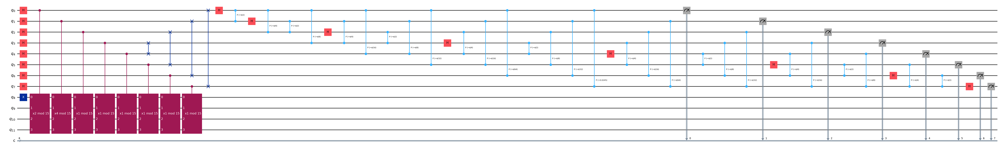
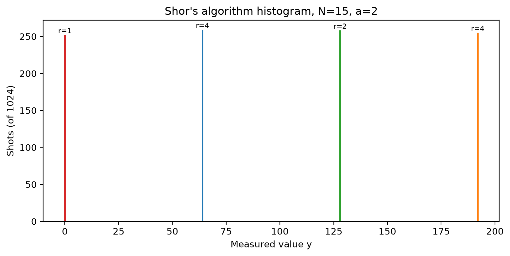
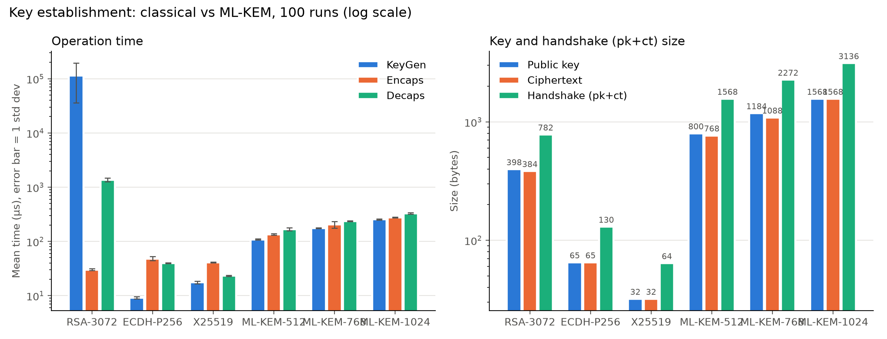
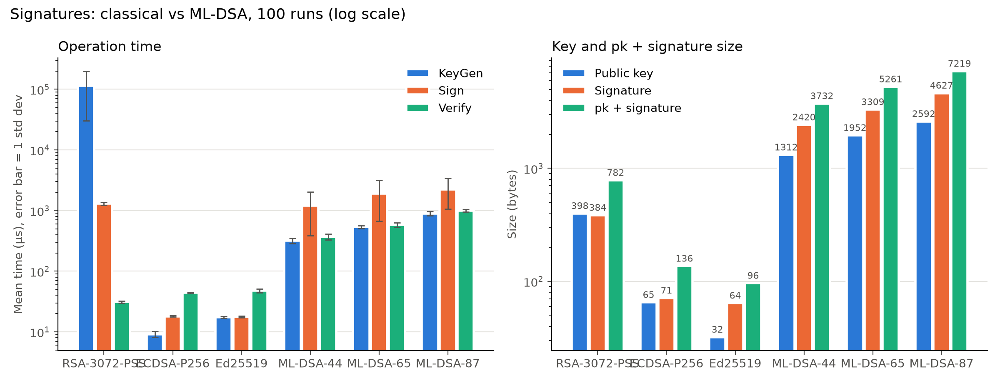
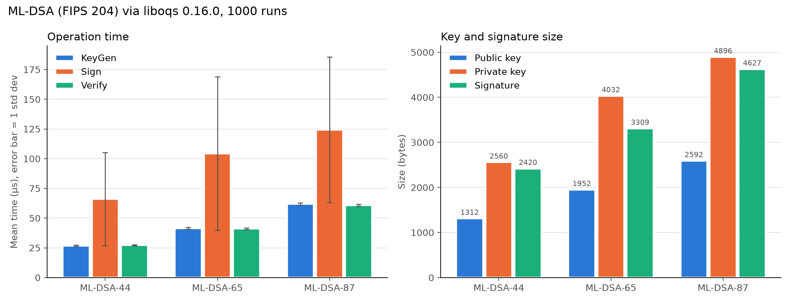
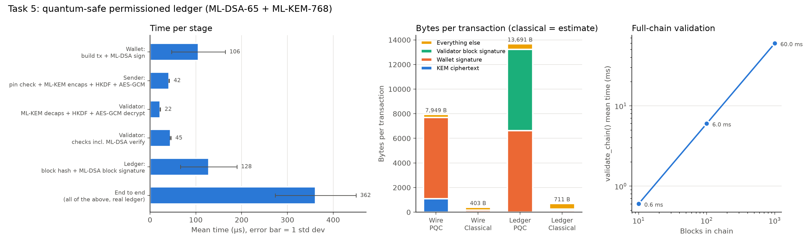

# From Quantum Vulnerability to Quantum-Safe Systems: Analysing the Transition from Classical to Post-Quantum Cryptography

**CCS528 Technical Paper 1**
AU WAI LIK (25203542) · TIFFANY TIEN NEE PRAGASAM (25203306)

---

## Abstract

Public-key cryptography that we use in our daily lives relies heavily on two problems. The first is integer factorisation, which keeps Rivest–Shamir–Adleman (RSA) safe, and the second is the discrete logarithm problem, which keeps Diffie–Hellman and Elliptic Curve Cryptography (ECC) safe. Shor's algorithm can solve both problems in polynomial time once a fault-tolerant quantum computer exists. This paper examines that threat and the lattice-based replacements that NIST has standardised: ML-KEM, defined in FIPS 203 [1], and ML-DSA, defined in FIPS 204 [2].

This paper builds on the group's programming assignment, published in a GitHub repository [3]. It includes a 12-qubit simulation of Shor's algorithm that factors N = 15 and recovers a toy RSA private key, implementations of ML-KEM and ML-DSA with tampering tests, and a 200-run benchmark comparing them with RSA-3072, ECDH/ECDSA P-256, X25519 and Ed25519.

Three findings stand out. Against RSA, PQC is faster: ML-KEM-768 key generation is about 9,000 times faster than RSA-3072. Against elliptic curves, the cost is mainly size rather than computation: an ML-KEM-768 handshake is 35 times larger than X25519, and an ML-DSA-65 public key plus signature is 55 times larger than Ed25519. In a blockchain setting, signature size drives storage growth.

Building on these findings, this paper proposes a quantum-safe permissioned ledger architecture. The prototype implements its core: ML-DSA-65 for transaction authentication and an ML-KEM-768 channel with AES-256-GCM for confidentiality. It detected replay, ciphertext-tampering, key-substitution and ledger-mutation attacks. The proposed design extends the prototype with three measures that have not yet been implemented: a hybrid X25519 + ML-KEM-768 key exchange, and two storage measures, binary encoding and checkpointed signature pruning. Finally, this paper discusses the security, performance, practicality and limitations of the proposed design, and concludes that migrating to PQC is mainly a challenge of size and integration rather than speed.

**Keywords:** post-quantum cryptography, Shor's algorithm, Module-LWE, ML-KEM, ML-DSA, blockchain

---

## 1. Introduction

Public-key cryptography allows two parties who have never met to agree on a shared secret key (key establishment) and to prove who created a message (digital signatures). Together these provide confidentiality, integrity, authenticity and non-repudiation, and they underpin TLS, PKI certificates, online banking, software updates and blockchains. Almost all deployed systems rely on RSA [4] or Elliptic Curve Cryptography (ECC) [5], whose security rests on the assumption that integer factorisation and discrete logarithms cannot be solved in any practical amount of time.

Quantum computing challenges that assumption. A classical bit is either 0 or 1, while a quantum bit (qubit) can exist in a superposition of both, so a register of *n* qubits is described by 2ⁿ complex amplitudes at once. Quantum algorithms use interference so that the amplitudes of wrong answers cancel and those of correct answers reinforce, and measurement then returns one outcome with probability equal to the squared magnitude of its amplitude. This does not speed up every computation, but it is very effective for problems with hidden periodic structure, which is exactly the structure behind RSA and ECC.

Shor's algorithm [6] exploits this to solve factoring and discrete logarithms in polynomial time, so a sufficiently large fault-tolerant quantum computer would break RSA, Diffie–Hellman and ECC completely. Grover's algorithm [7] gives only a quadratic speed-up for brute-force search, so symmetric ciphers such as AES-256 remain secure. The threat is already urgent. Mosca's inequality [8] shows that if the time data must stay secret plus the time needed to migrate is longer than the time until a cryptographically relevant quantum computer exists, that data is already at risk, because adversaries can record ciphertext today and decrypt it later ("harvest now, decrypt later"). NIST has therefore standardised lattice-based replacements, ML-KEM (FIPS 203) [1] and ML-DSA (FIPS 204) [2], and its transition plan [9] supports the U.S. federal target of completing the migration by 2035, with high-impact systems required to migrate key establishment by 2030 and digital signatures by 2031.

This paper addresses the research question: *"How does quantum computing challenge the security foundations of current public-key cryptography, and how can lattice-based Post-Quantum Cryptography (PQC) be practically integrated into emerging digital systems?"* It builds on the group's programming assignment [3], which includes a 12-qubit simulation of Shor's algorithm, implementations of ML-KEM and ML-DSA with tampering tests, a classical-versus-PQC benchmark, and a quantum-safe permissioned blockchain prototype. Blockchain was chosen as the emerging system because its signatures are long-lived, its traffic is sensitive and every byte is stored permanently, so it exposes the costs of PQC clearly.

The paper moves from theory to experimental evidence, security implications and design, and is organised as follows. Section 2 analyses the security foundations of RSA and ECC and how Shor's algorithm breaks them. Section 3 explains why lattice-based cryptography, through LWE and Module-LWE, is the leading replacement. Section 4 compares the roles of ML-KEM and ML-DSA. Section 5 presents and analyses the experimental results. Section 6 proposes a quantum-safe permissioned ledger architecture. Section 7 discusses its security, performance, practicality and limitations. Section 8 outlines future work, and Section 9 concludes.

---

## 2. Why Quantum Computing Threatens Current Cryptography

### 2.1 Classical security foundations

**RSA** [4] publishes a modulus *N = pq* and an exponent *e*. The private exponent is *d ≡ e⁻¹ mod φ(N)*, where *φ(N) = (p−1)(q−1)*. Anyone who can factor *N* can compute *φ(N)* and therefore *d*. RSA is therefore at most as hard as factoring. The best classical factoring algorithm, the General Number Field Sieve, runs in sub-exponential time *L_N[1/3, 1.923]* [10]. This is why RSA needs 3072-bit moduli for 128-bit security. Each doubling of the security level needs a much larger increase in key size.

**Diffie–Hellman and DSA** rely on the discrete logarithm problem (DLP): given *g* and *h = gˣ mod p*, find *x*. The DLP in finite fields also falls to number-field-sieve variants in sub-exponential time.

**ECC** [5] uses the Elliptic Curve DLP (ECDLP): given points *P* and *Q = kP* on a curve, find *k*. No sub-exponential method is known for well-chosen curves. The best generic attack is Pollard's rho, which takes *O(√n)* steps. This *fully exponential* hardness is why a 256-bit curve gives the same 128-bit security as 3072-bit RSA, and it explains the large size gap we measured (65 B vs 398 B public keys; Section 5).

All three problems share one property: **they can be reduced to finding the period of a function over an abelian group.** For RSA, the function is *f(x) = aˣ mod N*. For DLP and ECDLP, it is a two-variable function whose period encodes the secret exponent or scalar. Classical computers cannot find such periods efficiently. A quantum computer can.

### 2.2 How Shor's algorithm breaks the assumption

Shor's algorithm [6] factors *N* in roughly *O((log N)³)* quantum gates. It does this by finding the order *r* of a random *a* modulo *N*:

1. Prepare a counting register in an equal superposition.
2. Compute *aˣ mod N* into a work register (modular exponentiation).
3. Apply the inverse Quantum Fourier Transform (QFT). Because *f* is periodic, interference concentrates the probability on outcomes *y ≈ s·2ⁿ/r*.
4. Measure, then recover *r* classically using continued fractions on *y/2ⁿ*.
5. If *r* is even and *a^(r/2) ≢ −1 (mod N)*, then *gcd(a^(r/2) ± 1, N)* gives the factors.

The same approach, applied to a two-dimensional hidden period, solves the DLP and ECDLP [6]. This means Shor's algorithm does not just *weaken* RSA and ECC; it breaks them completely. Increasing classical parameters only raises the attack cost polynomially (Section 3.1).

Grover's algorithm [7] is the other relevant quantum algorithm. It gives only a quadratic speed-up for brute-force key search, so AES-256 keeps about 128-bit security. This asymmetry is why the post-quantum designs in this paper keep symmetric primitives (AES-256-GCM, SHA-256, HKDF) and replace only the public-key layer.

### 2.3 Results from the Shor's Algorithm Simulation

**Worked example: N = 15, a = 2.** First check that gcd(2, 15) = 1, so *a* shares no factor with *N*. Then list the powers of *a* modulo *N*:

- 2¹ mod 15 = 2
- 2² mod 15 = 4
- 2³ mod 15 = 8
- 2⁴ mod 15 = 1
- 2⁵ mod 15 = 2 (the sequence repeats)

The period *r* is the smallest positive integer for which *aʳ ≡ 1 (mod N)*, so here **r = 4**. Since *r* is even and *2² = 4 ≢ −1 (mod 15)*, the factors follow from

*gcd(2² − 1, 15) = gcd(3, 15) = 3* and *gcd(2² + 1, 15) = gcd(5, 15) = 5*,

so *15 = 3 × 5*. For such a small *N*, listing the powers is easy. For a 2048-bit *N* the period is astronomically long and no known classical method can find it efficiently. Finding it is the step that Shor's algorithm performs with the inverse QFT.

The group's Qiskit simulation carries out exactly this computation for *N = 15* using 12 qubits: 8 counting qubits and 4 work qubits. It runs on a noise-free simulator with 1024 shots and 5 repeats for every valid *a*.

Across all valid values of *a*, about half of the measurements reveal the period, except for *a = 14*, which never succeeds (full results in Table 3, Section 5). These success rates follow directly from the theory.

- **Period r = 4 (a = 2).** The QFT produces four equally likely peaks at *y = 0, 64, 128, 192*. Only *y = 64* and *y = 192* reduce to *s/r = 1/4* and *3/4*, which reveal *r = 4*. The peak at *y = 128* reduces to *1/2*, which suggests *r = 2*. That candidate is rejected because *2² mod 15 = 4 ≠ 1*. The peak at *y = 0* carries no information. So two of four peaks succeed, giving about 50%.
- **a = 14 always fails.** Here *14 ≡ −1 (mod 15)*, so *a^(r/2) ≡ −1* and the gcd step returns only the trivial factors 1 and 15.

This shows why Shor's algorithm is *probabilistic* and has to retry with different values of *a*. Once the factors 3 and 5 are known, the rest of the attack is classical: *φ(N) = 8*, *d = 7⁻¹ mod 8 = 7*, and the intercepted ciphertext decrypts to the original message. The attacker used nothing except the public key.

### 2.4 Toy demonstration vs real-world attack

The simulation must not be mistaken for a real attack. Its modular multiplier is **hard-coded for N = 15**: multiplying by *a* mod 15 reduces to a few qubit swaps and bit flips, so the circuit was built using knowledge of the answer. Smolin et al. [11] call this "oversimplifying" quantum factoring: such circuits demonstrate the algorithm but are not evidence of scalable factoring capability. A real attack has to build modular exponentiation for a 2048-bit *N* out of reversible arithmetic, and that step dominates the cost of the whole algorithm.

**Table 1. Toy demonstration vs resource estimates for real keys.**

| Target | Logical qubits | Physical qubits (error-corrected) | Source |
|---|---|---|---|
| N = 15 (simulation) | 12 | — (noise-free simulator) | Group's simulation |
| RSA-2048 | ~6,000 | ~20 million, about 8 hours | Gidney & Ekerå, 2021 [12] |
| RSA-2048 | — | < 1 million, under a week | Gidney, 2025 [13] |
| ECC P-256 | ~2,330 | — | Roetteler et al., 2017 [14] |

The estimates support two observations.

1. **The gap is engineering, not mathematics.** Physical-qubit estimates for RSA-2048 fell about 20× in four years through better algorithms and error-correction layouts, so the threat timeline is shrinking faster than hardware progress alone would suggest.
2. **ECC is the easier quantum target, even though it is the stronger classical one.** P-256 needs fewer logical qubits than RSA-2048 because its keys are much shorter [14]. Many systems, including TLS, Bitcoin, Ethereum and FIDO2, depend on ECC, so moving from RSA to ECC gives no quantum protection.

---

## 3. Why Lattice-Based Cryptography?

### 3.1 Why a larger RSA key is not enough

Shor's algorithm runs in polynomial time in the key length, while RSA key generation and decryption also grow polynomially (about cubic). Larger keys therefore raise the costs of the defender and of a quantum attacker by similar amounts, and the large security margin that classical factoring gives RSA disappears. Bernstein et al. [15] showed that "post-quantum RSA" is technically possible, but it would need keys of about **1 terabyte**.

Our own data already shows the strain at 3072 bits. RSA-3072 key generation took **115 ± 79 ms**, roughly 650× slower than ML-KEM-768 and with a very large variance from the prime search. A defensible response therefore needs problems that have *no hidden periodic structure for a quantum computer to exploit*. This is the aim of **Post-Quantum Cryptography (PQC)**: classical algorithms, running on ordinary hardware, whose security rests on problems believed hard for both classical and quantum computers. NIST's PQC process evaluated lattice, code-based, hash-based, multivariate and isogeny families [16]. Lattice schemes were standardised for general use because they offer the best overall balance of speed, size and security evidence.

### 3.2 Lattices and the Shortest Vector Problem

A **lattice** *L(B) = {Σ zᵢbᵢ : zᵢ ∈ ℤ}* is the set of all integer combinations of the basis vectors *b₁…bₙ ∈ ℝⁿ*. It forms a regular, infinite grid of points. The same lattice has many bases. A "good" basis is short and nearly orthogonal, while a "bad" basis is long and skewed, and the bad basis hides the lattice's geometry.

The **Shortest Vector Problem (SVP)** asks for the shortest non-zero lattice vector. In 2 dimensions it is trivial. The difficulty comes from working in **high dimensions**, typically *n* in the hundreds. There, the best known algorithms (sieving and enumeration, with BKZ reduction) take time exponential in *n*. Quantum versions give only small constant-factor improvements to the exponent. There is no known quantum algorithm that does for SVP what Shor's algorithm does for factoring, because lattice problems have no abelian hidden-subgroup structure to exploit.

### 3.3 Learning With Errors and the role of noise

Regev's **Learning With Errors (LWE)** problem [17] turns lattice hardness into a usable cryptographic assumption. Given a random matrix *A ∈ ℤ_q^(m×n)* and

  **b = A·s + e (mod q)**,

where *s* is secret and *e* is a vector of small random **errors (noise)**, the task is to recover *s*, or even to distinguish *b* from random.

- **Without noise**, Gaussian elimination recovers *s* in polynomial time.
- **With noise**, the system becomes a closest-vector problem on a lattice built from *A*.

The noise is not a flaw in the scheme; it is the source of its security. It must be large enough to hide *s*, but small enough that the legitimate decryptor can round it away. This balance explains two properties we observed later: why ML-KEM has a (negligible) decryption-failure probability, and why ML-DSA uses rejection sampling.

Regev also proved a **worst-case to average-case reduction** [17]. Solving *random* LWE instances is at least as hard as solving *worst-case* approximate lattice problems such as GapSVP and SIVP, which are believed hard even for quantum computers. RSA and ECC have no such guarantee.

### 3.4 Module-LWE: structure for efficiency

Plain LWE needs a large *A* (about *n²* entries), which makes keys big. **Ring-LWE** replaces integers with polynomials in *R_q = ℤ_q[X]/(Xⁿ+1)*, so a single polynomial represents an *n×n* structured block. This shrinks keys and enables fast NTT multiplication, at the price of more algebraic structure. **Module-LWE** [18] sits between the two: *A* is a small *k×k* matrix of ring elements.

ML-KEM fixes *n = 256* and *q = 3329*, and uses **k = 2, 3, 4** for its three security levels. Security is tuned simply by changing *k*, without changing the underlying ring arithmetic. Our measurements confirm this: ML-KEM's public key grows linearly (800 → 1,184 → 1,568 B) as *k* goes 2 → 3 → 4. Module-LWE was chosen as a deliberate compromise. It keeps less algebraic structure than Ring-LWE, which reduces the risk of structure-exploiting attacks, while staying nearly as efficient.

---

## 4. Building Quantum-Resistant Cryptographic Systems

### 4.1 Different roles: key establishment vs signatures

ML-KEM and ML-DSA are not interchangeable. They solve different problems.

**Table 2. The roles of ML-KEM and ML-DSA.**

| | ML-KEM (FIPS 203) [1] | ML-DSA (FIPS 204) [2] |
|---|---|---|
| Purpose | Establish a shared secret | Prove who authored data, and that it is unchanged |
| Security property | Confidentiality (IND-CCA2) | Authenticity, integrity, non-repudiation (EUF-CMA) |
| Hard problem | Module-LWE | Module-LWE + Module-SIS |
| Replaces | RSA-OAEP, ECDH, X25519 | RSA-PSS, ECDSA, Ed25519 |
| Quantum urgency | **Immediate** (harvest now, decrypt later) | Before a CRQC exists, especially for long-lived keys |
| Does *not* provide | Authentication of the peer | Confidentiality |

A KEM alone is vulnerable to man-in-the-middle substitution of the public key, and a signature alone reveals the message. A complete system needs both, plus symmetric cryptography.

### 4.2 ML-KEM and its integration with symmetric encryption

ML-KEM is the standardised form of CRYSTALS-Kyber. Its three operations are:

- **KeyGen.** Sample *A* from a seed ρ, and small *s, e*. The public key is *pk = (t = A·s + e, ρ)* and the decapsulation key contains *s*, *pk*, *H(pk)* and a random rejection value *z*.
- **Encaps(pk).** Choose a random 32-byte *m*, derive *(K, r) = G(m ‖ H(pk))*, and encrypt *m* under *pk* using the coins *r*. The output is the ciphertext *ct* and the **shared secret K**.
- **Decaps(sk, ct).** Decrypt to get *m′*, **re-encrypt** it, and compare the result with *ct*. If they match, output *K*. Otherwise output *J(z ‖ ct)*, a pseudorandom key unrelated to *K* (**implicit rejection**).

The re-encryption check is the Fujisaki–Okamoto transform [19]. It turns an IND-CPA lattice encryption into an IND-CCA2 KEM. Our negative test confirmed its behaviour: a one-bit change to *ct* produced a *different* secret, with no error message. An attacker who tampers with *ct* therefore learns nothing from the response; there is no decryption-failure oracle to exploit.

A KEM transports a key, not data. Our implementation uses the **KEM-DEM** pattern:

  *K* → HKDF-SHA-256 (with *info* bound to SHA-256(*ct*), one key per direction) → AES-256-GCM.

Binding *ct* into the key-derivation context ties each session key to one specific handshake. AES-GCM supplies confidentiality and integrity for the data, and it rejected every tampered ciphertext and every altered piece of associated data with `InvalidTag`. This is the same structure as TLS 1.3's hybrid `X25519MLKEM768` group [20].

### 4.3 ML-DSA: signing, verification and its security contribution

ML-DSA (CRYSTALS-Dilithium) uses **Fiat–Shamir with aborts** [21]:

- **KeyGen.** The public key is *t = A·s₁ + s₂*, compressed to *t₁*. The secret key contains the small vectors *s₁, s₂*.
- **Sign.** Compute the message representative *μ = H(H(pk) ‖ ctx ‖ M)*. Sample a mask *y*, compute the commitment *w = A·y*, derive the challenge *c = H(μ ‖ w₁)*, and compute the response *z = y + c·s₁*. **If *z* would leak information about *s₁*, abort and retry.** The signature is *σ = (c̃, z, h)*.
- **Verify.** Recompute *w₁′* from *(A, t₁, z, c, h)* and accept only if *c̃ = H(μ ‖ w₁′)* and *z* is short.

These steps map onto three security properties, each of which our Task 3 experiments tested.

- **Integrity.** Changing "RM 5,000" to "RM 9,000" (2 of 608 bits) flipped about half of μ's 512 bits, and verification failed. All 16 tampering attacks were rejected, covering changes to the message, the signature fields, the key and the context string.
- **Authentication.** Forging a signature requires solving Module-SIS (finding a short *z*). Mallory's signature made with her own key was rejected under Alice's public key. However, our control case showed that the same signature verifies under *Mallory's* key. A signature therefore proves possession of a private key, not identity. **Binding public keys to identities (via a PKI or registry) is a separate requirement**, and Section 6 addresses it.
- **Non-repudiation.** Only Alice holds *sk*, so a third party can attribute σ to her. A MAC or the AES-GCM tag cannot do this, because both parties share the key.

### 4.4 Critical comparison

ML-KEM and ML-DSA rest on the same Module-LWE foundation, which has a benefit and a risk:

- **Benefit:** one family of arithmetic (NTT over polynomial rings) can serve both, which simplifies hardware acceleration.
- **Risk:** the two schemes are not independent. A breakthrough against structured lattices would break both at once.

This *monoculture risk* is why NIST also standardised SLH-DSA (hash-based) and selected HQC (code-based) as backups, and why hybrid deployment is prudent during the transition.

The two schemes also differ in implementation risk:

- ML-DSA signing involves a secret-dependent rejection loop, which makes constant-time and side-channel-resistant implementation harder than for ML-KEM.
- ML-KEM has a small, non-zero decryption-failure probability (about 2⁻¹⁶⁴ for ML-KEM-768). This is negligible in practice, but it has no equivalent in RSA or ECDH.

---

## 5. Experimental Analysis: What We Gain and What We Sacrifice

**Experimental setup.** All results come from the group's programming assignment, run on one Linux x86_64 machine. ML-KEM and ML-DSA use liboqs 0.16.0 [22], and the classical schemes use the OpenSSL-backed `cryptography` library. Task 4 used 200 runs per operation. Times are means in microseconds (µs) and sizes are in bytes (B).

**Shor's algorithm simulation (Task 1).** Table 3 summarises the simulation of Shor's algorithm for N = 15 (12 qubits). The success rate of about 50% matches the theory in Section 2.3: for *a = 2*, two of the four equally likely measurement peaks reveal the period. For *a = 14*, *14 ≡ −1 (mod 15)*, so the method fails every time. The small circuit depth (16–29) and gate count (55–70) are possible only because the multiplier is hard-coded for N = 15, so they say nothing about the cost of attacking a real key (Section 2.4).

**Table 3. Shor's algorithm for N = 15 (simulation results).**

| *a* | True period *r* | Depth | Gates | Success rate |
|---|---|---|---|---|
| 2, 7, 8, 13 | 4 | 26–29 | 66–70 | 50.0–50.5% |
| 4, 11 | 2 | 16–20 | 57–61 | 49.7–50.1% |
| 14 | 2 | 16 | 55 | **0.0%** |



**Figure 1. Quantum circuit of Shor's algorithm for N = 15 and a = 2 (12 qubits: 8 counting, 4 work).** The Hadamard gates put the 8 counting qubits into an equal superposition, and the work register starts in the state 1. Counting qubit *k* then controls a modular multiplication by *a^(2^k) mod 15*, which is followed by the inverse QFT and the measurement of the counting register. For *a = 2* the multipliers are ×2, ×4 and then ×1 (because *2⁴ ≡ 1 mod 15*), so only the first two controlled gates change the work register. Each multiplier is built from a few swaps and bit flips, which is why the circuit is shallow (Section 2.4).



**Figure 2. Measurement histogram for N = 15 and a = 2 (1,024 shots).** The outcomes fall on four values only, *y = 0, 64, 128* and *192*, with roughly a quarter of the shots each. These are the phases *s/r = 0, 1/4, 1/2, 3/4* for the period *r = 4* (*y/256*). The label above each bar is the period estimated by continued fractions. The peaks at *y = 64* and *192* give *r = 4*, which is correct. The peak at *y = 128* gives *r = 2*, which is rejected because *2² mod 15 ≠ 1*, and *y = 0* gives *r = 1*, which carries no information. Only the two *r = 4* peaks lead to the factors, which is why the success rate in Table 3 is about 50%.

**Classical vs post-quantum benchmark (Task 4).** Tables 4 and 5 compare each PQC scheme with the classical schemes it replaces. The classical and PQC schemes are called through different libraries, so differences of a few times should be read as "the same order of magnitude" rather than as exact ratios. Differences of several orders of magnitude, such as RSA key generation, are robust.

**Table 4. Key establishment (mean ± std for key generation; mean for the rest; µs, sizes in B).**

| Scheme | PQ-safe | KeyGen | Encaps | Decaps | pk | ct | Handshake |
|---|---|---|---|---|---|---|---|
| RSA-3072 | No | 144,762 ± 85,899 | 39.9 | 1,491.2 | 398 | 384 | 782 |
| ECDH-P256 | No | 11.3 ± 0.5 | 68.2 | 56.6 | 65 | 65 | 130 |
| X25519 | No | 25.8 ± 3.0 | 53.6 | 28.0 | 32 | 32 | 64 |
| ML-KEM-512 | Yes | 12.0 ± 2.2 | 13.6 | 10.4 | 800 | 768 | 1,568 |
| ML-KEM-768 | Yes | 15.9 ± 0.4 | 17.6 | 15.1 | 1,184 | 1,088 | 2,272 |
| ML-KEM-1024 | Yes | 20.2 ± 2.3 | 21.6 | 20.4 | 1,568 | 1,568 | 3,136 |



**Figure 3. Key establishment: classical schemes vs ML-KEM (200 runs, log scale).** The left panel shows the mean time of each operation (error bars are one standard deviation), and the right panel shows the public-key, ciphertext and handshake sizes. In the left panel, RSA-3072 key generation is about four orders of magnitude above every other bar, while the ECC and ML-KEM bars all lie within the same range of roughly 10–70 µs. In the right panel the order is reversed: the ML-KEM bars are one to two orders of magnitude above the ECC bars (an ML-KEM-768 handshake is 2,272 B, against 64 B for X25519 and 130 B for P-256). Time therefore separates RSA from the other schemes, and size separates ML-KEM from ECC. Because both axes are logarithmic, small differences look smaller than they are, so exact ratios should be read from Table 4.

**Table 5. Digital signatures (mean ± std for key generation and signing; mean for verification; µs, sizes in B).**

| Scheme | PQ-safe | KeyGen | Sign | Verify | pk | σ | pk + σ |
|---|---|---|---|---|---|---|---|
| RSA-3072-PSS | No | 129,441 ± 82,571 | 1,519.0 ± 77.4 | 37.0 | 398 | 384 | 782 |
| ECDSA-P256 | No | 11.5 ± 1.1 | 20.8 ± 1.2 | 60.3 | 65 | 72 | 137 |
| Ed25519 | No | 25.8 ± 2.3 | 25.8 ± 1.5 | 82.6 | 32 | 64 | 96 |
| ML-DSA-44 | Yes | 26.7 ± 2.2 | 66.2 ± 37.3 | 27.7 | 1,312 | 2,420 | 3,732 |
| ML-DSA-65 | Yes | 42.4 ± 2.8 | 103.2 ± 56.2 | 42.7 | 1,952 | 3,309 | 5,261 |
| ML-DSA-87 | Yes | 62.8 ± 3.3 | 120.0 ± 50.5 | 61.8 | 2,592 | 4,627 | 7,219 |



**Figure 4. Digital signatures: classical schemes vs ML-DSA (200 runs, log scale).** The left panel shows the mean time of key generation, signing and verification, and the right panel shows the public-key, signature and public-key-plus-signature sizes. As in Figure 3, RSA-3072 key generation (about 130,000 µs) and signing (about 1,500 µs) stand far above the rest. Among the fast schemes, ML-DSA signing is slower than ECDSA and Ed25519 and has the widest relative error bars, which reflects the variable number of attempts in its rejection loop. ML-DSA verification is faster than both ECC schemes. The size panel again shows the main cost: an ML-DSA-65 public key plus signature is 5,261 B, against 96 B for Ed25519, 137 B for ECDSA-P256 and 782 B for RSA-3072.

### 5.1 Security

The gain from migrating is structural: every classical row in Tables 4 and 5 is broken by Shor's algorithm (Section 2), while ML-KEM and ML-DSA rely on Module-LWE, for which no quantum shortcut is known (Section 3). The comparison is not perfectly level, though. All the classical schemes sit at roughly NIST Level 1 (about 128-bit classical security), whereas ML-KEM-768 and ML-DSA-65 are Level 3. A strictly like-for-like comparison would use ML-KEM-512 (Level 1), and P-384 for Level 3, which was not benchmarked (Section 7.4).

### 5.2 Performance and computational requirements

The result depends on which classical scheme PQC replaces.

**Against RSA, PQC is much faster and more predictable.**

- ML-KEM-768 key generation (15.9 µs) is about **9,100× faster** than RSA-3072 (144.8 ms), and decapsulation is about **99× faster**. ML-DSA-65 signing is about **15× faster** than RSA-3072-PSS.
- RSA key generation varies widely (standard deviation 59% of the mean) because it searches for random primes. Lattice key generation is a fixed amount of sampling and NTT work, so its variation is about 3%.
- RSA keeps one advantage: verification with the small public exponent *e = 65537* (37.0 µs, against 42.7 µs for ML-DSA-65). This matters for systems that mostly verify, such as certificate checking.

**Against ECC, the two are in the same range, and neither wins everywhere.**

- **Key establishment:** a full ML-KEM-768 exchange (key generation, encapsulation and decapsulation) takes 48.6 µs, against 107.5 µs for X25519 and 136.1 µs for ECDH-P256, so ML-KEM is about 2–3× faster overall. Only key generation is slower than P-256 (15.9 vs 11.3 µs).
- **Signatures:** ML-DSA-65 signing (103.2 µs) is about 4–5× slower than Ed25519 and ECDSA (20.8–25.8 µs), but its verification (42.7 µs) is faster than both (60.3 and 82.6 µs).
- Every PQC operation takes about 0.12 ms or less. For a TLS handshake that already takes tens of milliseconds of network round-trip, the computation is not noticeable.

**ML-DSA signing has a heavy tail.** In Task 3 (1,000 runs), ML-DSA-65 signing had a mean of 104 µs and a median of 84 µs, but a maximum of 493 µs (about 4.7× the mean), while verification varied by only about 2%. This is the Fiat–Shamir-with-aborts loop from Section 4.3: FIPS 204 expects about 5.1 attempts per signature for ML-DSA-65 [2], and the number of attempts is random. Systems with real-time deadlines should therefore plan for **tail latency** (the 99th percentile), not the mean. The rejection loop is a security necessity, and this variance is its cost.



**Figure 5. ML-DSA-44, ML-DSA-65 and ML-DSA-87: operation times and sizes (Task 3, 1,000 runs, linear scale).** The left panel shows the mean time of key generation, signing and verification (error bars are one standard deviation), and the right panel shows the public-key, private-key and signature sizes. Key generation and verification take 27\u201362 \u00b5s and have almost invisible error bars (about 1 \u00b5s). Signing is slower (66\u2013124 \u00b5s) and its error bars are about 50\u201360% of the mean, which shows the variable number of attempts in the rejection loop. The figure shows only the mean and standard deviation, so the maximum signing time of 493 \u00b5s for ML-DSA-65 comes from the raw data. All three operations and all three sizes grow with the security level, and the ML-DSA-65 private key (4,032 B) is larger than its public key (1,952 B) and its signature (3,309 B).

### 5.3 Key, signature and ciphertext size

Size is where migration is really expensive.

| Comparison | Classical | PQC | Factor |
|---|---|---|---|
| Handshake: ML-KEM-768 vs X25519 | 64 B | 2,272 B | **35.5×** |
| Handshake: ML-KEM-768 vs RSA-3072 | 782 B | 2,272 B | 2.9× |
| pk + σ: ML-DSA-65 vs Ed25519 | 96 B | 5,261 B | **54.8×** |
| Signature: ML-DSA-65 vs RSA-3072 | 384 B | 3,309 B | 8.6× |

Sizes grow linearly with the security level (with the module rank *k* in ML-KEM), so moving from Level 1 to Level 5 roughly doubles them. The measured sizes match FIPS 203 and FIPS 204 exactly (checked by the repository's tests), which confirms that they are inherent properties of the schemes rather than implementation overhead.

### 5.4 Communication overhead and practical implications

The extra bytes have practical consequences beyond the raw ratios.

- **Packet fragmentation.** A single ML-DSA-65 signature (3,309 B) does not fit in a 1,500-byte Ethernet MTU, so it needs at least three packets. A certificate chain with two signatures and one public key is about 8.6 KB.
- **Constrained links.** An IEEE 802.15.4 frame (used in Zigbee and Thread) carries 127 B, so one ML-DSA-65 signature needs at least 27 frames, against one for Ed25519. For battery-powered devices, radio transmission energy is often greater than CPU energy, so bandwidth cost becomes battery cost.
- **Persistent storage (Task 5).** In the blockchain prototype, each transaction grew the ledger by **13,691 B**, against 711 B for the same design with Ed25519 and X25519 (an estimate in the evaluation, about 19× smaller). Two hex-encoded ML-DSA-65 signatures (the wallet signature and the validator's block signature, 6,618 B each) make up about 97% of that. A ledger stores every signature permanently, so the size difference becomes an ongoing storage cost. Chain validation also grows linearly (0.6 ms for 10 blocks, 6.0 ms for 100 and 60 ms for 1,000), because every block signature is verified.



**Figure 6. Task 5 prototype evaluation (1,000 runs).** The left panel shows the time of each stage of one transaction (mean \u00b1 one standard deviation): wallet signing about 106 \u00b5s, sender-side encryption about 42 \u00b5s, validator decryption about 22 \u00b5s, validator checks including signature verification about 45 \u00b5s, and block hashing and signing about 128 \u00b5s, for an end-to-end mean of about 362 \u00b5s. The middle panel compares the bytes per transaction of the PQC design with a classical Ed25519 + X25519 estimate: 7,949 B against 403 B on the wire, and 13,691 B against 711 B on the ledger. Two ML-DSA-65 signatures (the wallet's and the validator's block signature, 6,618 B each) make up most of the ledger size. In the right panel, chain validation time grows linearly with the number of blocks, because each block signature has to be verified.

**What we gain and what we sacrifice.** Compared with RSA, migrating gains quantum resistance *and* speed, at a 3–9× size cost. Compared with ECC, it gains quantum resistance at a similar computation cost but a 35–55× size cost. For most systems, the practical question is therefore not "is PQC fast enough?" but "**can our protocol, network and storage handle the bytes?**" This conclusion drives the design in Section 6.

---

## 6. Designing Security for the Quantum Era: A Quantum-Safe Permissioned Ledger

### 6.1 Environment and security problem

We chose **permissioned blockchain**, as used for inter-bank settlement and supply-chain records. It is a particularly demanding case for three reasons:

1. **Signatures are long-lived.** A ledger records history permanently. If ECDSA is broken, an attacker can derive private keys from public keys exposed on-chain and **forge transactions that look historically valid**. Unlike encrypted traffic, these records cannot simply be rotated away.
2. **Submission traffic contains sensitive data** (amounts and payment notes). This makes it a "harvest now, decrypt later" target.
3. **Every byte is replicated and stored forever**, so the size costs from Section 5.3 multiply across nodes and over time.

**Threat model.** The attacker can read, modify, replay and inject network traffic, alter stored blocks, and may later have access to a CRQC. The attacker cannot extract private keys from endpoints. Consensus attacks and side channels are out of scope.

**Security requirements:**

| ID | Requirement |
|---|---|
| R1 | Transaction authenticity and non-repudiation |
| R2 | Confidentiality of submissions in transit |
| R3 | Integrity of ledger history |
| R4 | Replay resistance |
| R5 | Resistance to quantum attacks on all public-key operations |
| R6 | Bounded storage and bandwidth growth |

### 6.2 Architecture

```
 ┌────────────────────┐  (1) Enrolment: ML-DSA pk + identity  ┌───────────────────────────┐
 │  Wallet / Client   │──────────────────────────────────────▶│  Trusted Registry         │
 │                    │◀──────────────────────────────────────│  • participant ML-DSA pks │
 │ • ML-DSA-65 sk/pk  │  (2) Registry entries signed by       │  • validator KEM pk       │
 │ • addr=SHA-256(pk) │      the registry's ML-DSA-87 key     │    fingerprints           │
 └─────────┬──────────┘                                       └─────────────┬─────────────┘
           │ (3) tx = {sender, recipient, amount, nonce, ts, alg_id}        │ pinned
           │     σ  = ML-DSA-65.Sign(sk, tx, ctx="ledger-v1")               │ fingerprints
           ▼                                                                │
 ┌──────────────────────────────────────────────────────────────┐           │
 │  Hybrid Secure Channel                                       │◀──────────┘
 │  (4) check validator KEM pk fingerprint against the registry │
 │  (5) K1 = X25519,  (ct, K2) = ML-KEM-768.Encaps(pk_V)        │
 │  (6) k  = HKDF-SHA-256(K1 ‖ K2, info = H(ct) ‖ session id)   │
 │  (7) AES-256-GCM(k, tx ‖ σ, AAD = H(ct) ‖ sender ‖ nonce)    │
 └─────────────────────────────┬────────────────────────────────┘
                               ▼
 ┌──────────────────────────────────────────────────────────────┐
 │  Validator Node                                              │
 │  (8)  ML-KEM.Decaps → HKDF → AES-GCM decrypt (tag check)     │
 │  (9)  verify σ against the registered pk                     │
 │  (10) nonce == expected? balance ≥ amount?                   │
 └─────────────────────────────┬────────────────────────────────┘
                               ▼
 ┌──────────────────────────────────────────────────────────────┐
 │  Hash-Linked Ledger (SHA-256)                                │
 │  Block_i = {prev_hash, txs (binary-encoded), Merkle root}    │
 │  (11) every C blocks: checkpoint signed with ML-DSA-87       │
 │       by a validator quorum → signatures before it are       │
 │       moved to archival storage                              │
 └──────────────────────────────────────────────────────────────┘
```

### 6.3 Components and cryptographic roles

| Component | Mechanism | Requirement | Justification |
|---|---|---|---|
| Transaction signing | ML-DSA-65, context string `ledger-v1` | R1, R5 | Level 3 balances size against long-term security. The context string prevents a signature from being reused across protocols, which our Task 3 context-mismatch test confirmed. |
| Identity binding | Registry entries signed with ML-DSA-87; address = SHA-256(pk) | R1 | Closes the gap shown by our "Mallory's own key" control (Section 4.3). The registry is the most long-lived key, so it gets Level 5. |
| Key establishment | **Hybrid** X25519 + ML-KEM-768 | R2, R5 | The session stays secure if *either* scheme holds. This guards against undiscovered weaknesses in a young standard, as in TLS `X25519MLKEM768` [20]. Costs only +64 B over ML-KEM alone. |
| Validator key pinning | Fingerprint check before encapsulation | R2 | ML-KEM does not authenticate the peer. Our Task 5 KEM-key-substitution attack was rejected by this check. |
| Data protection | HKDF-SHA-256 → AES-256-GCM, AAD bound to H(ct), sender and nonce | R2, R3 | AES-256 holds about 128-bit security against Grover's algorithm. The AAD binding stops ciphertexts being spliced across sessions. |
| Replay defence | Per-sender nonce | R4 | Our replay attack was rejected (`expected 1, got 0`). |
| Ledger integrity | SHA-256 hash chain + Merkle root | R3 | Our ledger-mutation attack produced `validate_chain() = False`. |
| **Size control** | Binary encoding + checkpointed signature pruning | R6 | See Section 6.4. |
| **Crypto-agility** | `alg_id` field in every transaction | R5 | Allows a later migration (for example to SLH-DSA) without a hard fork. |

### 6.4 Original contribution: size-aware ledger design

Sections 5.3–5.4 showed that **signature bytes, not CPU time**, are the binding constraint for a PQC ledger. Our prototype measured 7,050 B per transaction, and we propose two optimisations that follow directly from that measurement:

1. **Binary encoding.** Storing σ as raw bytes instead of hex halves the signature footprint, from 6,618 to 3,309 B. Ledger growth falls from about 7.0 KB to roughly 3.7 KB per transaction. This needs no change to the cryptography.
2. **Checkpointed signature pruning.** Once a quorum of validators has verified the transactions and signed a checkpoint over the Merkle root of the blocks so far, the individual transaction signatures before that checkpoint are no longer needed to establish the current state. They can move to cold archival storage, kept for audit and non-repudiation. Active nodes keep only the hash chain plus a few ML-DSA-87 checkpoint signatures. This idea is similar to Bitcoin's segregated witness, but the motivation here is PQC signature size.

Together, these measures keep the security benefits of PQC while controlling the size cost of PQC signatures, which is the main issue a quantum-safe ledger has to manage in practice.

### 6.5 Normal workflow and prototype evidence

Our Task 5 prototype implements steps 1, 3–10 and the SHA-256 chain. It does not yet include hybrid key exchange, signed registry entries or pruning. Over 50 transactions it measured:

| Metric | Value |
|---|---|
| ML-DSA-65 sign / verify (median) | 0.93 ms / 0.60 ms |
| ML-KEM-768 encaps / decaps (median) | 0.21 ms / 0.26 ms |
| AES-GCM encryption (median) | 0.003 ms |
| End-to-end transaction latency (median) | **2.88 ms** |
| Throughput (single process) | **317 tx/s** |
| Ledger growth | 7,050 B per transaction |
| Full-chain validation, 50 blocks (median) | 0.84 ms |

All four implemented attacks were detected: replay, ciphertext tampering, KEM key substitution and ledger mutation. Signing and verification account for about half of the end-to-end latency, while AES-GCM is negligible. This repeats the pattern from Section 5: the public-key layer dominates computation, and signature size dominates storage.

---

## 7. Discussion

### 7.1 Security

| Property | Addressed by | Remaining gap |
|---|---|---|
| Confidentiality | Hybrid KEM + AES-256-GCM | Ledger contents are visible to all permissioned nodes. Confidentiality *from other members* would need further encryption or zero-knowledge proofs. |
| Integrity | AES-GCM tag, ML-DSA, SHA-256 chain | — |
| Authentication | ML-DSA + signed registry | The registry is a trust anchor and a single point of compromise. |
| Quantum threats | All public-key operations are PQC; the symmetric primitives are sized for Grover | Security rests on Module-LWE alone: a lattice breakthrough breaks both ML-KEM and ML-DSA (Section 4.4). The hybrid KEM mitigates this for confidentiality, but not for signatures. |

Hybrid *signatures* (ECDSA + ML-DSA) would close the last gap, but they add more bytes to the dimension that is already the most constrained. We chose not to use them. This is a deliberate trade-off, and it could be revisited as confidence in ML-DSA grows.

### 7.2 Performance

PQC adds four kinds of cost:

- **Processing:** about 2.9 ms per transaction, of which signing and verification are about half.
- **Memory:** the ML-DSA-65 secret key is 4,032 B, against 32 B for Ed25519.
- **Bandwidth:** about 4.5 KB per submission (signature + ciphertext + public key).
- **Latency:** heavy-tailed signing.

At 317 tx/s on a single core, the prototype already exceeds the throughput most permissioned settlement networks need. Verification parallelises across cores because each signature is independent.

### 7.3 Practicality

For servers and validators, the design is deployable today with standard libraries (liboqs, and OpenSSL 3.5 or later). The harder case is **constrained clients**. A hardware wallet or IoT sensor with a few KB of RAM and a low-bandwidth radio struggles to hold a 4 KB secret key and send a 3.3 KB signature (27 or more 802.15.4 frames). Three options exist:

- use ML-DSA-44 (2,420 B) where Level 2 is acceptable;
- delegate signing to a gateway (a trust trade-off);
- wait for future compact schemes such as FN-DSA (Falcon), whose signatures are about 666 B.

Migrating an existing ledger also requires re-keying every account, and accounts whose keys are lost can never be migrated. Operators need a migration policy before a CRQC exists.

### 7.4 Limitations

- **Shor simulation.** The multiplier circuit was compiled using the known answer and run on a noise-free simulator, so the simulation demonstrates the *mechanism* of the attack, not its feasibility at scale (Section 2.4).
- **Benchmarks.** These are single-machine Python measurements. Absolute times include wrapper overhead (a separate Linux run of Task 2 gave ML-KEM times about 10× lower). We did not measure energy, memory under load, or embedded hardware, and the classical baselines were not matched at NIST Levels 3 and 5.
- **Prototype.** It has no consensus layer, network transport, hybrid KEM, pruning or side-channel hardening. Section 6's extensions are proposed, not yet implemented.

### 7.5 Future work

1. Implement the hybrid KEM and checkpoint pruning, and measure how much storage pruning actually saves.
2. Benchmark on an ARM Cortex-M4 (for example with pqm4) to quantify the constrained-client case.
3. Compare ML-DSA with FN-DSA and SLH-DSA in the ledger setting, to test the size/speed/assumption-diversity trade-off.
4. Extend the Shor simulation to a general modular-exponentiation circuit (for example *N = 21*), to measure how quickly resources grow with *N*.

---

## 8. Conclusion

Quantum computing breaks RSA and ECC because their hard problems all reduce to finding a period, and Shor's algorithm finds periods efficiently. Our 12-qubit simulation showed the mechanism end to end, from period finding to private-key recovery, while the published resource estimates show that the gap between that demonstration and RSA-2048 is closing. Larger keys cannot fix a polynomial-time attack. Lattice problems, made practical by Module-LWE, offer worst-case hardness guarantees and no known quantum shortcut.

Our measurements show that the price of migration is mainly **size, not speed**. ML-KEM and ML-DSA outperform RSA computationally but are 35–55× larger than their ECC counterparts. Our ledger design therefore treats bandwidth and storage as first-class concerns, alongside hybrid key exchange, identity binding and crypto-agility. Quantum-safe migration is ultimately a systems-engineering problem: the algorithms are standardised, and the remaining challenge is to integrate them into protocols, devices and data structures that were designed around much smaller keys and signatures.

---

## References

[1] NIST, *Module-Lattice-Based Key-Encapsulation Mechanism Standard*, FIPS 203, Aug. 2024, doi: [10.6028/NIST.FIPS.203](https://doi.org/10.6028/NIST.FIPS.203).

[2] NIST, *Module-Lattice-Based Digital Signature Standard*, FIPS 204, Aug. 2024, doi: [10.6028/NIST.FIPS.204](https://doi.org/10.6028/NIST.FIPS.204).

[3] W. L. Au and T. T. N. Pragasam, "CCS528 Programming Assignment 1: From Shor to Lattices," GitHub repository, 2026. [Online]. Available: [https://github.com/WaiLik-11/CCS528-Assignment-1](https://github.com/WaiLik-11/CCS528-Assignment-1)

[4] R. L. Rivest, A. Shamir, and L. Adleman, "A method for obtaining digital signatures and public-key cryptosystems," *Commun. ACM*, vol. 21, no. 2, pp. 120–126, 1978, doi: [10.1145/359340.359342](https://doi.org/10.1145/359340.359342).

[5] N. Koblitz, "Elliptic curve cryptosystems," *Math. Comput.*, vol. 48, no. 177, pp. 203–209, 1987, doi: [10.1090/S0025-5718-1987-0866109-5](https://doi.org/10.1090/S0025-5718-1987-0866109-5).

[6] P. W. Shor, "Polynomial-time algorithms for prime factorization and discrete logarithms on a quantum computer," *SIAM J. Comput.*, vol. 26, no. 5, pp. 1484–1509, 1997, doi: [10.1137/S0097539795293172](https://doi.org/10.1137/S0097539795293172). Preprint: [arXiv:quant-ph/9508027](https://arxiv.org/abs/quant-ph/9508027).

[7] L. K. Grover, "A fast quantum mechanical algorithm for database search," in *Proc. 28th ACM STOC*, 1996, pp. 212–219. Preprint: [arXiv:quant-ph/9605043](https://arxiv.org/abs/quant-ph/9605043).

[8] M. Mosca, "Cybersecurity in an era with quantum computers: Will we be ready?" *IEEE Secur. Privacy*, vol. 16, no. 5, pp. 38–41, 2018, doi: [10.1109/MSP.2018.3761723](https://doi.org/10.1109/MSP.2018.3761723). Preprint: [IACR ePrint 2015/1075](https://eprint.iacr.org/2015/1075).

[9] D. Moody, R. Perlner, A. Regenscheid, A. Robinson, and D. Cooper, *Transition to Post-Quantum Cryptography Standards*, NIST IR 8547, Oct. 2026, doi: [10.6028/NIST.IR.8547](https://doi.org/10.6028/NIST.IR.8547).

[10] A. K. Lenstra and H. W. Lenstra Jr., Eds., *The Development of the Number Field Sieve*, Lecture Notes in Mathematics, vol. 1554. Berlin, Germany: Springer, 1993, doi: [10.1007/BFb0091534](https://doi.org/10.1007/BFb0091534).

[11] J. A. Smolin, G. Smith, and A. Vargo, "Oversimplifying quantum factoring," *Nature*, vol. 499, pp. 163–165, 2013, doi: [10.1038/nature12290](https://doi.org/10.1038/nature12290). Preprint (titled "Pretending to factor large numbers on a quantum computer"): [arXiv:1301.7007](https://arxiv.org/abs/1301.7007).

[12] C. Gidney and M. Ekerå, "How to factor 2048 bit RSA integers in 8 hours using 20 million noisy qubits," *Quantum*, vol. 5, p. 433, 2021, doi: [10.22331/q-2021-04-15-433](https://doi.org/10.22331/q-2021-04-15-433). Preprint: [arXiv:1905.09749](https://arxiv.org/abs/1905.09749).

[13] C. Gidney, "How to factor 2048 bit RSA integers with less than a million noisy qubits," arXiv:2505.15917, 2025. [Online]. Available: [https://arxiv.org/abs/2505.15917](https://arxiv.org/abs/2505.15917)

[14] M. Roetteler, M. Naehrig, K. M. Svore, and K. Lauter, "Quantum resource estimates for computing elliptic curve discrete logarithms," in *Proc. ASIACRYPT*, 2017, pp. 241–270. Preprint: [arXiv:1706.06752](https://arxiv.org/abs/1706.06752).

[15] D. J. Bernstein, N. Heninger, P. Lou, and L. Valenta, "Post-quantum RSA," in *Proc. PQCrypto*, 2017, pp. 311–329. Preprint: [IACR ePrint 2017/351](https://eprint.iacr.org/2017/351).

[16] G. Alagic et al., *Status Report on the Third Round of the NIST Post-Quantum Cryptography Standardization Process*, NIST IR 8413, 2022, doi: [10.6028/NIST.IR.8413](https://doi.org/10.6028/NIST.IR.8413).

[17] O. Regev, "On lattices, learning with errors, random linear codes, and cryptography," *J. ACM*, vol. 56, no. 6, pp. 1–40, 2009, doi: [10.1145/1568318.1568324](https://doi.org/10.1145/1568318.1568324).

[18] A. Langlois and D. Stehlé, "Worst-case to average-case reductions for module lattices," *Des. Codes Cryptogr.*, vol. 75, no. 3, pp. 565–599, 2015, doi: [10.1007/s10623-014-9938-4](https://doi.org/10.1007/s10623-014-9938-4). Preprint: [IACR ePrint 2012/090](https://eprint.iacr.org/2012/090).

[19] D. Hofheinz, K. Hövelmanns, and E. Kiltz, "A modular analysis of the Fujisaki–Okamoto transformation," in *Proc. TCC*, 2017, pp. 341–371. Preprint: [IACR ePrint 2017/604](https://eprint.iacr.org/2017/604).

[20] K. Kwiatkowski, P. Kampanakis, B. Westerbaan, and D. Stebila, "Post-quantum hybrid ECDHE-MLKEM key agreement for TLSv1.3," IETF Internet-Draft draft-ietf-tls-ecdhe-mlkem (work in progress). [Online]. Available: [https://datatracker.ietf.org/doc/draft-ietf-tls-ecdhe-mlkem/](https://datatracker.ietf.org/doc/draft-ietf-tls-ecdhe-mlkem/)

[21] V. Lyubashevsky, "Fiat–Shamir with aborts: Applications to lattice and factoring-based signatures," in *Proc. ASIACRYPT*, 2009, pp. 598–616, doi: [10.1007/978-3-642-10366-7_35](https://doi.org/10.1007/978-3-642-10366-7_35).

[22] D. Stebila and M. Mosca, "Post-quantum key exchange for the Internet and the Open Quantum Safe project," in *Proc. SAC*, 2016, pp. 14–37. Preprint: [IACR ePrint 2016/1017](https://eprint.iacr.org/2016/1017).
