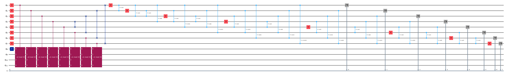
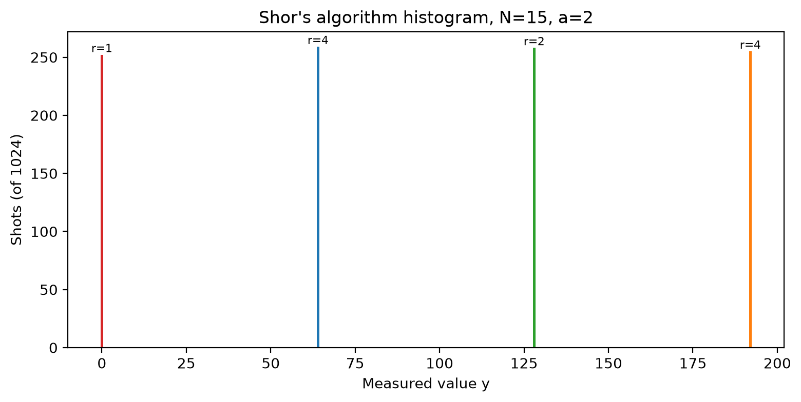

# Task 1: BREAK, Factoring an RSA Modulus with Shor's Algorithm

```bash
uv run python -m task1_shor.main
```

This prints every stage of the attack for `a = 2`, saves the circuit diagram and measurement
histogram to `results/figures/task1/`, breaks the toy RSA key, then measures qubits, circuit
depth, gate counts, execution time and success rate for every valid `a` (repeated 5 times each),
saved to `results/data/task1/shor_results.json`. The program has no command-line options.

## 1. What the program does

The toy RSA key uses `N = 15 = 3 x 5` (kept secret) and public exponent `e = 7`. The attacker only
ever sees the public key `(N, e)` and an intercepted ciphertext `c`.

| Stage | What happens | Evidence produced |
|---|---|---|
| 1. Input N, choose a | `N = 15`, attacker picks `a = 2` | Printed |
| 2. GCD check | `gcd(a, N)`; if it is not 1, a factor is already found classically | Printed |
| 3. Quantum period finding | Counting register in superposition, controlled multiplications by `a^(2^k) mod N` on a 4-qubit work register | Circuit diagram (`shor_circuit_a2.png`) |
| 4. Inverse QFT | Converts the hidden period into measurable phases | Part of the saved circuit |
| 5. Measurement | 1024 shots | Histogram (`histogram_a2.png`) |
| 6. Period estimation | `y / 2^n_count` -> closest fraction `s/r` (continued fractions) | Printed per measured state |
| 7. Classical factor extraction | `gcd(a^(r/2) - 1, N)` and `gcd(a^(r/2) + 1, N)` | Printed |
| 8. Breaking RSA | `phi(N) = (p-1)(q-1)`, private key `d = e^-1 mod phi(N)`, ciphertext decrypted | Printed |
| 9. Metrics | Qubits, depth, gates, time, success rate for every valid `a`, 5 repeats each | `results/data/task1/shor_results.json` |

The modular multiplication (`build_multiplier`) is hard-coded for `N = 15`: multiplying the
4-qubit work register by `1, 2, 4, 7, 8, 11, 13, 14 mod 15` only ever permutes or flips its qubits,
so no arithmetic gates are needed. The number of counting qubits follows the standard rule
`n_count = 2 x bits(N)` (`2 x 4 = 8` here), giving 12 qubits in total.

## 2. Results

### Circuit diagram and histogram (a = 2)





With `a = 2`, the true period is `r = 4`, so the inverse QFT concentrates the 1024 shots onto 4
peaks at `y = 0, 64, 128, 192` out of 256 possible 8-bit outcomes (each peak labelled with its
recovered period `r` in the histogram). Each peak is a multiple `s/r` of the phase `y / 256`:

| y | phase y/256 | estimated r | check | result |
|---|---|---|---|---|
| 0   | 0   | 1 | `r` is odd | no factors |
| 64  | 1/4 | 4 | 2^4 mod 15 = 1, and 2^2 mod 15 = 4 (not 14) | factors 3 and 5 |
| 128 | 1/2 | 2 | 2^2 mod 15 = 4, not 1 | wrong period, rejected |
| 192 | 3/4 | 4 | 2^4 mod 15 = 1, and 2^2 mod 15 = 4 (not 14) | factors 3 and 5 |

Only `y = 64` and `y = 192` (where `s` and `r = 4` share no common factor) reveal the true period,
so the success rate is close to 50%, not 100%. Shor's algorithm is probabilistic: a failed shot is
simply discarded, and a handful of shots is enough to find the factors.

### Metrics across every valid a (shots = 1024, 5 repeats each)

| a | true period r | qubits | depth | gates | time (ms) | success rate |
|---|---|---|---|---|---|---|
| 2  | 4 | 12 | 26 | 66 | 7.15 ± 1.55 | 50.0% ± 1.0% |
| 4  | 2 | 12 | 16 | 57 | 6.85 ± 0.57 | 50.1% ± 1.2% |
| 7  | 4 | 12 | 29 | 70 | 7.18 ± 0.46 | 50.5% ± 1.3% |
| 8  | 4 | 12 | 26 | 66 | 7.37 ± 1.05 | 50.3% ± 1.8% |
| 11 | 2 | 12 | 20 | 61 | 7.23 ± 0.58 | 49.7% ± 1.6% |
| 13 | 4 | 12 | 29 | 70 | 6.91 ± 1.10 | 50.2% ± 0.9% |
| 14 | 2 | 12 | 16 | 55 | 7.56 ± 1.09 | 0.0% ± 0.0% |

Raw data: [results/data/task1/shor_results.json](../results/data/task1/shor_results.json).

Observations:
- **`a = 4` and `a = 11` have a true period of only 2**, so half their shots land on the
  uninformative `y = 0` peak, but the other half still factor `N` correctly (~50% success).
- **`a = 14` always fails.** `14 = -1 mod 15`, so `14^1 mod 15 = 14 = N - 1`, which the classical
  post-processing correctly recognises as giving only the trivial factors 1 and 15 (never 3 and 5).
  This demonstrates why Shor's algorithm tries several values of `a` rather than a fixed one.
- Circuit depth and gate count depend on which of the fixed swap/flip patterns `a` needs: `a = 7
  and 13` need 3 swaps *and* a bit-flip (depth 29), `a = 2 and 8` need 3 swaps with no flip
  (depth 26), `a = 11` needs 2 swaps and a flip (depth 20), and `a = 4, 14` need the fewest gates.
- All runs complete in a few milliseconds on the noise-free simulator, with 12 qubits total.

### Breaking the toy RSA key (a = 2)

```
Factors of 15: 3 and 5
phi(N) = (3-1)(5-1) = 8
Private key recovered: d = 7^-1 mod 8 = 7
Decrypted ciphertext: 8^7 mod 15 = 2 (original message was 2)
```

## 3. How this breaks RSA

RSA's private key `d` stays secret only because nobody can efficiently factor the public modulus
`N` back into its two primes `p` and `q`. Classically, the best known factoring algorithms take
sub-exponential time, which is why a 2048-bit `N` is considered safe today. Shor's algorithm
replaces the hard factoring step with an efficient quantum period-finding subroutine: once the
period `r` of `a^x mod N` is known, `gcd(a^(r/2) +/- 1, N)` recovers `p` and `q` in polynomial
time. From there, everything is classical and fast: `phi(N) = (p-1)(q-1)`, then
`d = e^-1 mod phi(N)`, and the private key is rebuilt. The run above shows this end to end: the
quantum step recovers `p = 3, q = 5`, and the classical steps that follow recover `d = 7` and
decrypt the intercepted ciphertext back to the original message, with no information beyond the
public key `(N, e)` and the ciphertext ever being used.

## 4. Limitations

- **The modular multiplication circuit is hard-coded for `N = 15`.** Each multiplier is just a
  fixed set of qubit swaps/flips, worked out by hand for this specific modulus. A general, large
  `N` needs a full modular exponentiation circuit built from reversible arithmetic, which is by
  far the most expensive part of Shor's algorithm in practice (it dominates both qubit count and
  gate count).
- **This runs on a noise-free simulator (`AerSimulator`), not real quantum hardware.** Real
  devices have gate errors, limited qubit connectivity and decoherence, all of which would lower
  the measured success rate and require error correction overhead not modelled here.
- **Qubit estimates for RSA-2048.** This demo uses 12 qubits for `N = 15` (8 counting + 4 work
  qubits, following `n_count = 2 x bits(N)`). Factoring a real RSA-2048 key needs on the order of
  `2 x 2048 = ~4096` logical qubits for the counting and work registers alone, and several
  thousand more physical qubits once quantum error correction is included, well beyond what any
  current quantum computer provides.
