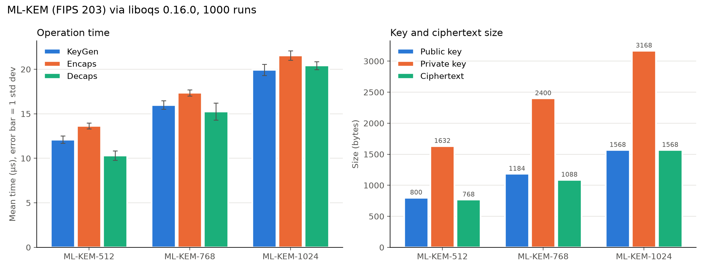

# Task 2: PROTECT, Post-Quantum Key Establishment with ML-KEM (FIPS 203)

```bash
uv run python -m task2_mlkem.main                    # walkthrough (ML-KEM-768)
uv run python -m task2_mlkem.main --kem ML-KEM-1024  # walkthrough with another parameter set
uv run python -m task2_mlkem.main --benchmark        # walkthrough + benchmark (default: 1000 runs)
```

Benchmark outputs: `results/data/task2/mlkem_benchmark.json` and `results/figures/task2/mlkem_benchmark.png`.

## 1. What the program does

ML-KEM comes from the Open Quantum Safe library (`liboqs` 0.16, through `liboqs-python`). It is called through the shared wrappers in [`common/pqc.py`](../common/pqc.py).

| Part | Flow | Evidence produced |
|------|------|-------------------|
| 1. Key establishment | **Alice** `KeyGen` → (pk, sk), sends pk → **Bob** `Encaps(pk)` → (ct, ss) and sends ct → **Alice** `Decaps(sk, ct)` → ss' | Prints pk, ct, ss and ss', then compares ss == ss' in constant time |
| 2. Negative tests | (A) one bit of ct is flipped; (B) Eve decapsulates ct with her own sk | Both produce a different secret. (A) is *implicit rejection*: there is no error, and the output is deterministic |
| 3. Secure session | ss → HKDF-SHA-256 (info is bound to SHA-256(ct), one key per direction) → AES-256-GCM | Bob and Alice exchange encrypted messages. A flipped ciphertext bit, altered AAD, or a key from a tampered KEM ciphertext each raise `InvalidTag` |
| 4. Measurements | ML-KEM-512/768/1024, N = 1000 runs after 5 warm-up calls | Mean, std and median of keygen, encaps and decaps times; pk, sk and ct sizes |

## 2. Results (example run: Linux x86-64, Python 3.12, liboqs 0.16.0)

| Parameter set | NIST Level | KeyGen (µs) | Encaps (µs) | Decaps (µs) | Public key (B) | Private key (B) | Ciphertext (B) |
|---|---|---|---|---|---|---|---|
| ML-KEM-512  | 1 (≈AES-128) | 12.1 ± 0.4 | 13.6 ± 0.3 | 10.3 ± 0.5 |  800 | 1632 |  768 |
| ML-KEM-768  | 3 (≈AES-192) | 16.0 ± 0.5 | 17.4 ± 0.4 | 15.3 ± 0.9 | 1184 | 2400 | 1088 |
| ML-KEM-1024 | 5 (≈AES-256) | 19.8 ± 0.6 | 21.6 ± 0.5 | 20.4 ± 0.4 | 1568 | 3168 | 1568 |



Observations:
- **Every operation finishes in tens of microseconds**, so ML-KEM adds almost no computational cost to a handshake. Going from ML-KEM-512 (level 1) to ML-KEM-1024 (level 5) makes key generation 1.65× slower, encapsulation 1.58× and decapsulation 1.98×, so decapsulation grows fastest.
- **Size is the main cost.** Key and ciphertext sizes grow linearly with the module rank k = 2, 3, 4. ML-KEM-768 sends 1184 + 1088 = 2272 bytes per handshake, compared with 64 bytes for X25519 (Task 4 compares this directly). The shared secret is always 32 bytes.
- The measured sizes match FIPS 203 Table 3 exactly.
- Measurement caveat: the times are wall-clock through the Python/ctypes wrapper and include creating the liboqs context, so they overstate the raw C cost. The overhead is the same for all three sets, so the comparison between them is still valid. Rerun on the demo machine before quoting numbers.

## 3. The role of ML-KEM in post-quantum security

**The threat.** Today's key establishment (RSA key transport, finite-field DH and ECDH) depends on factoring or on discrete logarithms. Shor's algorithm (Task 1) solves both in polynomial time by finding the period of a modular function. An adversary can record encrypted traffic now and decrypt it once a large quantum computer exists ("harvest now, decrypt later"). Key establishment is therefore the most urgent part of a protocol to migrate: a signature only has to stay unforgeable while it is being verified, but confidentiality has to last for the whole lifetime of the data.

**Why ML-KEM resists it.** ML-KEM is based on the **Module Learning With Errors (MLWE)** problem. The public key is roughly t = A·s + e over the ring R_q = Z_q[X]/(X^256 + 1) with q = 3329, where A is a public k×k matrix and s, e are small secret polynomials. Recovering s means solving a noisy linear system, which reduces to hard problems on structured lattices. Shor's algorithm relies on a hidden periodic structure (a hidden abelian subgroup), and MLWE has none. The best known quantum attacks are lattice sieving, with at most modest quantum speed-ups. Grover's search only gives a square-root speed-up on brute force, and the parameter sets are sized for that. The 32-byte shared secret is then used as an AES-256 key, and AES-256 keeps about 128-bit security against Grover.

**How the KEM works.** ML-KEM is the FIPS 203 version of CRYSTALS-Kyber. It applies the Fujisaki–Okamoto transform to an IND-CPA public-key encryption scheme (K-PKE) to make it **IND-CCA2 secure**:
- *Encaps* picks a random m, derives (ss, r) = G(m ‖ H(pk)), and encrypts m under pk using randomness r. Because encapsulation is randomized, every session gets a fresh secret.
- *Decaps* decrypts to m', **re-encrypts** m' and compares the result with ct. If they differ, it returns ss* = J(z ‖ ct), where z is a secret random value stored in sk (*implicit rejection*). Test A shows this. An attacker who modifies ct never sees an error, so there is no decryption-failure oracle to exploit. They only get an unrelated, deterministic key, and the AES-GCM layer then rejects their messages (Test D).

**A KEM, not key exchange.** ML-KEM does not compute a DH-style g^ab. The sender encapsulates a fresh secret to the receiver's public key, much like RSA key transport but quantum-resistant. A KEM only provides confidentiality of the key. It does **not** authenticate who sent pk: a man-in-the-middle could swap in their own pk. In practice, pk is authenticated with a signature (ML-DSA, Task 3) or pinned in a trusted registry. Task 5 does the latter by checking the validator's ML-KEM key fingerprint before encapsulating.

**From shared secret to session (KEM-DEM).** The KEM establishes the key and a symmetric scheme protects the data. HKDF-SHA-256 extracts and expands ss into separate AES-256 keys for each direction, with the KEM ciphertext hash in `info` so each key is tied to one specific handshake. AES-256-GCM then provides confidentiality and integrity for the messages and their associated data. This is the same pattern as TLS 1.3's hybrid `X25519MLKEM768` group and Task 5's secure channel.

## 4. Limitations

- There is one KEM exchange and no authentication of pk (see above), so it does not provide forward secrecy across multiple sessions or handle key rotation.
- The private key stays inside the liboqs context. It is exported once, only to measure its size, and is never printed or written to disk. There is no constant-time or side-channel evaluation; that is left to liboqs.
- Timings come from a single machine and run through Python.
