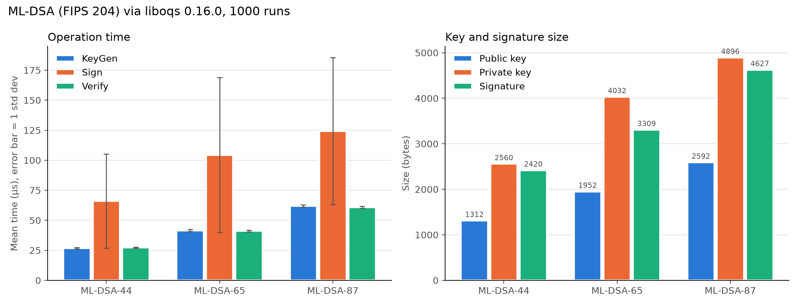

# Task 3: PROTECT, Post-Quantum Digital Signatures with ML-DSA (FIPS 204)

```bash
uv run python -m task3_mldsa.main                     # Experiments A and B, tampering tests (ML-DSA-65)
uv run python -m task3_mldsa.main --sig ML-DSA-87     # same experiments with another parameter set
uv run python -m task3_mldsa.main --benchmark         # experiments + measurements for ML-DSA-44/65/87 (default: 1000 runs)
```

Benchmark outputs: `results/data/task3/mldsa_benchmark.json` and `results/figures/task3/mldsa_benchmark.png`. The timings and sizes are measured only by `--benchmark`, so run it to get the six metrics that Experiment B asks for.

To validate the logic with the included tests:

```bash
uv run pytest tests/task3_test.py -v
```

## 1. What the program does

ML-DSA comes from the Open Quantum Safe library (`liboqs` 0.16, through `liboqs-python`). It is called through the shared `PQCSigner` wrapper in [`common/pqc.py`](../common/pqc.py), the same wrapper that signs transactions in Task 5. Alice signs a payment instruction and Bob verifies it:

> M = `Alice authorises payment of RM 5,000 to Bob, account 1234, ref INV-2026-118.`

| Part | Flow | Evidence produced |
|------|------|-------------------|
| 1. Signing | **Alice** `KeyGen` → (pk, sk) → `Sign(sk, M)` → σ → **Bob** `Verify(pk, M, σ)` | Prints pk, the sk size, the message representative μ, σ and the verification result |
| A. Original message | Bob verifies the unmodified (M, σ). Alice then signs M a second time | `VALID`. The second signature is different (hedged signing) and also verifies |
| B. Tampered message | Mallory changes `RM 5,000` to `RM 9,000` (2 of 608 bits) and keeps σ | `INVALID`. μ changes in about half its 512 bits |
| 4. More tampering | 16 attacks on the message, signature, public key and context string, plus 2 control cases that must verify | All 16 rejected, both controls accepted |
| 5. Measurements (`--benchmark`) | ML-DSA-44/65/87, N = 1000 runs after 5 warm-up calls | Mean, std, median and max of keygen, sign, verify and verify-of-tampered-M times; pk, sk and σ sizes |

### Experiment B metrics (ML-DSA-65, from `--benchmark`)

| # | Metric | Value |
|---|--------|-------|
| i | Key generation time | 41.6 ± 0.8 µs (median 41.3 µs) |
| ii | Signing time | 104.4 ± 64.5 µs (median 84.1 µs) |
| iii | Verification time (valid σ) | 41.1 ± 0.8 µs (median 40.9 µs) |
| | Verification time (tampered M, rejected) | 41.1 ± 0.8 µs (median 40.9 µs) |
| iv | Public-key size | 1952 bytes |
| v | Private-key size | 4032 bytes |
| vi | Signature size | 3309 bytes |

### Tampering matrix

| Target | Modification | Result | What it shows |
|--------|--------------|--------|---------------|
| Message | 1 bit flipped, trailing space added, last byte removed, emptied | Rejected | Integrity covers every bit and the length of M |
| Signature | 1 bit flipped in c̃, in z, or in the hint h | Rejected | Each part of σ is checked. A change anywhere in σ is caught |
| Signature | Truncated, extended by one byte, all zeros | Rejected | Malformed encodings are rejected without an exception |
| Signature | A valid σ that Alice made for a *different* message | Rejected | A signature cannot be moved to another message |
| Key | Alice's σ checked with Mallory's pk | Rejected | σ is bound to the signer's key, through tr = H(pk) inside μ |
| Key | Mallory signs M\* with her own sk; Bob checks it with Alice's pk | Rejected | **Authenticity**: without Alice's sk, Mallory cannot make a signature that Alice's pk accepts |
| Key | One bit of pk flipped | Rejected | A corrupted key verifies nothing |
| Context | Signed with ctx `CCS528-payment`, verified with no ctx or with ctx `CCS528-other` | Rejected | FIPS 204 context strings stop a signature made for one purpose being reused for another |
| *Control* | Same ctx on both sides | Accepted | The rejections above come from the changes, not from a broken verifier |
| *Control* | Mallory's σ on M\*, checked with Mallory's pk | Accepted | A signature proves who holds a private key, not who that person is. pk must be authenticated |

## 2. Results across parameter sets (example run: Linux x86-64, Python 3.12, liboqs 0.16.0)

| Parameter set | NIST Level | KeyGen (µs) | Sign (µs) | Verify (µs) | Public key (B) | Private key (B) | Signature (B) |
|---|---|---|---|---|---|---|---|
| ML-DSA-44 | 2 (≈SHA-256 collision) | 26.8 ± 0.6 |  66.1 ± 39.1 (median  53.2) | 27.2 ± 0.5 | 1312 | 2560 | 2420 |
| ML-DSA-65 | 3 (≈AES-192)           | 41.6 ± 0.8 | 104.4 ± 64.5 (median  84.1) | 41.1 ± 0.8 | 1952 | 4032 | 3309 |
| ML-DSA-87 | 5 (≈AES-256)           | 61.9 ± 1.0 | 124.4 ± 61.2 (median 105.2) | 60.9 ± 0.9 | 2592 | 4896 | 4627 |



Observations:
- **Signing is the slowest operation and varies the most.** Its standard deviation is about 50–60% of the mean, and the slowest samples take 5–6× the median. Key generation and verification vary by only 1–3%. The cause is the *Fiat–Shamir with aborts* loop. The signer throws away any candidate signature whose response z could leak information about sk, then tries again with a fresh mask. FIPS 204 expects about 4.25, 5.1 and 3.85 attempts on average for ML-DSA-44, 65 and 87. This is why ML-DSA-87 signs only 1.2× slower than ML-DSA-65, while its key generation is 1.5× slower. The median is the better number for typical latency.
- **Verification runs in a fixed amount of work and does not stop early on a forgery.** Checking the tampered message from Experiment B takes the same time as checking a valid signature (41.1 µs for both with ML-DSA-65), so timing does not reveal *where* a forgery went wrong.
- **Size costs more than time.** An ML-DSA-65 signature is 3309 B and its public key is 1952 B. Ed25519 uses 64 B and 32 B, and ECDSA P-256 uses about 72 B and 64 B (Task 4 compares them directly). A certificate chain that carries several signatures and keys grows by kilobytes. That matters for TLS handshakes, firmware images and blockchain transactions (Task 5) more than the microseconds of computation.
- Going from level 2 to level 5 makes keys and signatures about 1.9–2× larger and key generation and verification about 2.3× slower. On average, every operation still finishes within about 0.13 ms.
- The measured sizes match FIPS 204 Table 2 exactly (checked in `tests/task3_test.py`).
- Measurement caveat: the times are wall-clock through the Python/ctypes wrapper and include creating a liboqs context for key generation and verification, so they overstate the raw C cost. The overhead is the same for all three sets, so comparing them is still valid. Rerun on the demo machine before quoting numbers.

## 3. Integrity, authenticity and non-repudiation

**What ML-DSA signs.** ML-DSA does not sign M directly. It signs a 64-byte *message representative*
μ = SHAKE256(tr ‖ M′), with tr = SHAKE256(pk) and M′ = 0 ‖ len(ctx) ‖ ctx ‖ M (FIPS 204, Algorithms 2 and 7).
The program computes μ itself (`message_representative`). The test suite checks it against liboqs: it signs our μ with the `ML-DSA-65-extmu` variant and confirms that plain ML-DSA accepts the result. So μ depends on three things: every bit of the message, the signer's public key, and the context string. The tampering matrix changes each of them in turn.

**Integrity: was the message changed?** In Experiment B only 2 bits of M change, but μ changes in about half of its 512 bits (254 in the recorded run; the exact number depends on the key), as expected from a good hash. Verification recomputes the signer's commitment w₁′ from (pk, z, h, μ\*) and checks that c̃ = H(μ\* ‖ w₁′). That equation only holds for the μ that Alice committed to when signing. The tampering tests show this in practice: every modification of the message and of the signature is rejected. A signature does not stop a message from being changed, and it does not hide it (ML-DSA gives no confidentiality; Task 2's AES-GCM layer does that). It makes any change *detectable* by anyone who holds the public key.

**Authenticity: who sent it?** Producing a valid σ for a new message requires sk. ML-DSA is EUF-CMA secure: even an attacker who has seen many of Alice's signatures cannot forge one on a message she did not sign. Without sk, Mallory has two options and both fail. She can reuse Alice's σ (transplant test) or sign with her own key (forgery test). The second control shows the limit of this guarantee. Mallory's forgery is *valid under Mallory's own pk*. A signature only proves "whoever holds the sk for this pk signed this". Linking that pk to *Alice* is a separate problem, solved by a certificate (PKI) or a trusted registry. Task 5 uses a registry, and it addresses wallets by a hash of their ML-DSA public key. The same assumption appears in Task 2: ML-KEM gives no authentication, so an ML-KEM public key is normally signed with ML-DSA to stop a man-in-the-middle.

**Non-repudiation: can Alice deny it later?** Only Alice holds sk, and anyone can check σ with the public pk, so a third party (an auditor, a bank, a court) can confirm that Alice authorised the payment. She cannot claim that Bob made it up. A MAC such as HMAC or the AES-GCM tag cannot provide this, because both parties share the same key, so either could have produced the tag. Non-repudiation still depends on key management: if sk leaks, or the key was never properly bound to Alice, the argument fails. ML-DSA is randomised by default ("hedged" signing, shown in Experiment A), so the same message gives a different σ each time. Every σ still verifies, so this does not weaken non-repudiation. It does mean that a σ cannot be used as a unique ID for a message.

**Why this is quantum-safe.** RSA-PSS, ECDSA and Ed25519 rest on factoring and discrete logarithms. Shor's algorithm (Task 1) breaks both, so a quantum attacker could compute sk from the public pk and forge any signature, which defeats both integrity and authenticity. ML-DSA (the FIPS 204 version of CRYSTALS-Dilithium) is based on **Module-LWE**, the same hidden-structure-free lattice problem as ML-KEM (see Task 2), and on **Module-SIS**: finding a short vector z with A·z ≈ c·t is what forging requires. Neither problem has the periodic structure that Shor's algorithm exploits. Signatures have different time pressure from encryption. There is no "harvest now, decrypt later" risk, because a signature only needs to stay unforgeable while someone still relies on it. But long-lived signatures, such as root CA certificates, firmware signing keys and blockchain transaction history, must be quantum-safe before a quantum computer exists. Otherwise an attacker could later forge entries that look historically valid.

## 4. Limitations

- There is one key pair and no PKI: Bob is simply *given* Alice's pk. The second control case shows why a real deployment needs certificates or a registry.
- The private key stays inside the liboqs context. It is exported once, only to measure its size, and is never printed or written to disk. There is no side-channel or fault-injection evaluation; that is left to liboqs. The pure (non-prehash) ML-DSA mode is used. HashML-DSA and the deterministic signing variant are not demonstrated.
- The tampering tests are evidence, not a proof. Unforgeability rests on the EUF-CMA security reduction, not on testing.
- Timings come from a single machine and run through Python.
