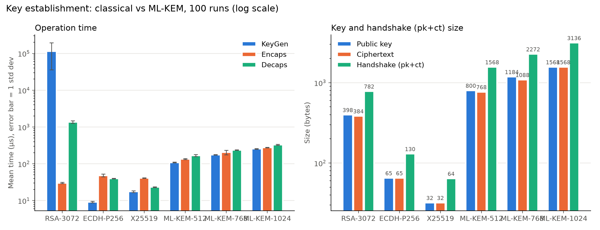
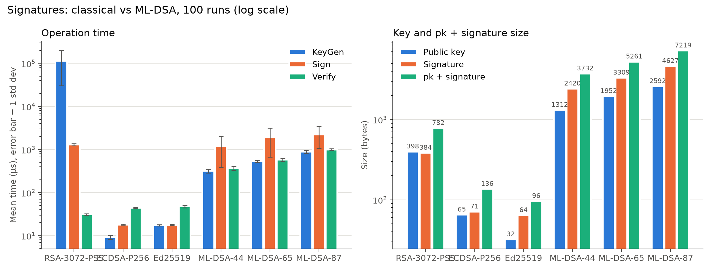

# Task 4: COMPARE, Classical versus Post-Quantum Cryptography

```bash
uv run python -m task4_benchmark.main                # 100 runs per operation (default)
uv run python -m task4_benchmark.main --runs 200      # more repeats, steadier mean/std, slower (RSA keygen dominates)
```

Outputs: `results/data/task4/{comparison.json, kem_comparison.csv, signature_comparison.csv}` and `results/figures/task4/{kem_comparison.png, signature_comparison.png}`.

## 1. What the program does

Task 4 does not introduce any new cryptography. It takes the classical baselines (RSA, ECDH, ECDSA, Ed25519) and benchmarks them the same way, then re-uses `measure()` from [task2_mlkem/main.py](../task2_mlkem/main.py) and [task3_mldsa/main.py](../task3_mldsa/main.py) directly, so the ML-KEM/ML-DSA numbers are exactly the same code already proven correct in Tasks 2 and 3.

| Comparison | Classical | Post-quantum | Metrics recorded |
|---|---|---|---|
| Key establishment | RSA-3072-OAEP, ECDH-P256, X25519 | ML-KEM-512 / 768 / 1024 | keygen time (wall-clock + CPU), encaps time, decaps time, public-key size, ciphertext size, handshake bytes |
| Digital signatures | RSA-3072-PSS, ECDSA-P256, Ed25519 | ML-DSA-44 / 65 / 87 | keygen time (wall-clock + CPU), sign time, verify time, public-key size, signature size, signed-message bytes |

Every classical scheme is wrapped in the same `(keygen, encaps, decaps)` / `(keygen, sign, verify)` shape as the PQC schemes, so all rows can be timed with the same `sample_ms()`/`summarize()` helpers and placed in one table. `keygen_cpu` is a second, independent timer (CPU time, i.e. user+system time) measured with `sample_cpu_ms()`, useful because RSA key generation time varies a lot (it searches for large primes) — CPU time confirms whether that variance is real computation or just OS scheduling noise. "Handshake bytes" / "signed-message bytes" is the communication-overhead metric: how many bytes actually have to cross the network for one exchange.

## 2. Results (`--runs 200`, Linux x86-64, Python 3.12, liboqs 0.16.0)

### Key establishment

| Scheme | PQ-safe | KeyGen (µs) | KeyGen CPU (µs) | Encaps (µs) | Decaps (µs) | Public key (B) | Ciphertext (B) | Handshake (B) |
|---|---|---|---|---|---|---|---|---|
| RSA-3072    | no  | 144,762 ± 85,899 | 163,977 ± 120,349 | 39.9 ± 6.1  | 1,491.2 ± 75.6 | 398   | 384   | 782   |
| ECDH-P256   | no  | 11.3 ± 0.5       | 11.4 ± 0.2        | 68.2 ± 3.4  | 56.6 ± 2.7     | 65    | 65    | 130   |
| X25519      | no  | 25.8 ± 3.0       | 25.9 ± 0.2        | 53.6 ± 2.3  | 28.0 ± 0.9     | 32    | 32    | 64    |
| ML-KEM-512  | yes | 12.0 ± 2.2       | 12.0 ± 0.1        | 13.6 ± 0.4  | 10.4 ± 0.3     | 800   | 768   | 1,568 |
| ML-KEM-768  | yes | 15.9 ± 0.4       | 16.1 ± 0.2        | 17.6 ± 1.9  | 15.1 ± 0.3     | 1,184 | 1,088 | 2,272 |
| ML-KEM-1024 | yes | 20.2 ± 2.3       | 19.9 ± 0.0        | 21.6 ± 0.3  | 20.4 ± 0.3     | 1,568 | 1,568 | 3,136 |

### Digital signatures

| Scheme | PQ-safe | KeyGen (µs) | KeyGen CPU (µs) | Sign (µs) | Verify (µs) | Public key (B) | Signature (B) | Signed message (B) |
|---|---|---|---|---|---|---|---|---|
| RSA-3072-PSS | no  | 129,441 ± 82,571 | 132,080 ± 115,905 | 1,519.0 ± 77.4 | 37.0 ± 2.0 | 398   | 384   | 782   |
| ECDSA-P256   | no  | 11.5 ± 1.1       | 11.7 ± 0.1        | 20.8 ± 1.2     | 60.3 ± 2.1 | 65    | 72    | 137   |
| Ed25519      | no  | 25.8 ± 2.3       | 26.0 ± 0.1        | 25.8 ± 1.5     | 82.6 ± 3.2 | 32    | 64    | 96    |
| ML-DSA-44    | yes | 26.7 ± 2.2       | 27.0 ± 0.0        | 66.2 ± 37.3    | 27.7 ± 2.1 | 1,312 | 2,420 | 3,732 |
| ML-DSA-65    | yes | 42.4 ± 2.8       | 42.7 ± 0.1        | 103.2 ± 56.2   | 42.7 ± 2.9 | 1,952 | 3,309 | 5,261 |
| ML-DSA-87    | yes | 62.8 ± 3.3       | 63.5 ± 0.2        | 120.0 ± 50.5   | 61.8 ± 3.8 | 2,592 | 4,627 | 7,219 |

The raw numbers are in `results/data/task4/`. "Handshake" is the public key plus the ciphertext, and "Signed message" is the public key plus one signature.




## 3. Security, performance and resource trade-offs

- **Time, key establishment:** RSA-3072 key generation takes about **145 ms and varies a lot** (±86 ms), because it searches for two large random primes. That is roughly 9,000× slower than ML-KEM-768 (15.9 µs), and RSA decapsulation (1.49 ms) is about 99× slower than ML-KEM-768 decapsulation (15.1 µs). ML-KEM is also faster than the elliptic-curve schemes in this measurement: ML-KEM-768 encapsulation takes 17.6 µs against 53.6 µs for X25519 and 68.2 µs for ECDH-P256, because an ECDH "encapsulation" has to generate an ephemeral key and then do a second scalar multiplication. Only ECDH-P256 key generation (11.3 µs) is faster than ML-KEM-512 (12.0 µs). RSA encapsulation (39.9 µs) is cheap because the public exponent is small.
- **Time, signatures:** ML-DSA key generation (26.7–62.8 µs) is 1–5× slower than ECDSA/Ed25519, and **signing is the slowest ML-DSA operation** (103.2 µs for ML-DSA-65, against 20.8 µs for ECDSA and 25.8 µs for Ed25519) with a large standard deviation, caused by the rejection-sampling loop (see Task 3). Verification is competitive: ML-DSA-65 (42.7 µs) is faster than Ed25519 (82.6 µs) and ECDSA (60.3 µs) here. RSA-3072 signing is the slowest at 1.52 ms (about 15× slower than ML-DSA-65), but its verification (37.0 µs) is the fastest of all schemes.
- **Size is the real cost of going post-quantum.** ML-KEM-768's 1,184-byte public key plus 1,088-byte ciphertext (2,272 bytes per handshake) is about **35× larger** than X25519's 64 bytes, 17× larger than ECDH-P256, and 2.9× larger than RSA-3072. ML-DSA-65's 1,952-byte key plus 3,309-byte signature (5,261 bytes) is about **55× larger** than Ed25519's 96 bytes, 38× larger than ECDSA, and 6.7× larger than RSA-3072. For a protocol with tight bandwidth (for example constrained IoT links), this matters more than CPU time.
- **Security.** None of the classical schemes is quantum-safe: Shor's algorithm (Task 1) breaks RSA, ECDH, X25519, ECDSA and Ed25519 alike, and key establishment is also exposed to "harvest now, decrypt later". RSA-3072, P-256, X25519 and Ed25519 all offer about 128-bit classical security (roughly NIST level 1), so the fairest comparison is against ML-KEM-512 (level 1). ML-KEM-768/1024 and ML-DSA-65/87 (levels 3 and 5) have no classical counterpart in this comparison.
- **CPU time** (measured for key generation) is almost identical to wall-clock time for every scheme, because each operation is single-threaded and never waits. For RSA-3072 both numbers are large and highly variable (standard deviation is 60–90% of the mean), so they should be read as "roughly 130–165 ms", not compared digit for digit.
- **Bottom line:** against RSA, ML-KEM and ML-DSA are faster for key generation, key establishment and signing, at the cost of larger keys and signatures. Against ECC, ML-KEM key generation is within about 2× and encapsulation/decapsulation are 2–4× faster, ML-DSA signs 4–5× more slowly, and both are 17–55× larger on the wire. The price of quantum safety is therefore mostly **bandwidth and storage**, not CPU time.

## 4. Limitations

- The numbers come from one machine (Linux x86-64, Python 3.12) and absolute values will differ on other hardware, though the relative ordering between schemes should not. Rerun on the demo machine before quoting them.
- The classical schemes run through OpenSSL (the `cryptography` package) and the PQC schemes through liboqs and its Python/ctypes wrapper, which creates a context on every call. This overstates the PQC times slightly, so the real gap in favour of ML-KEM/ML-DSA is, if anything, larger.
- `keygen_cpu` uses `time.process_time()`, a coarse OS clock. Fast key generations are therefore timed in batches of calls (see `sample_cpu_ms()` in [common/timing.py](../common/timing.py)) and averaged over 20 samples, instead of the 200 used for wall-clock time. This is why the RSA CPU numbers are noisier.
- Memory usage and CPU usage under concurrent load are not measured. The four metrics reported are wall-clock time, CPU time (key generation), key/ciphertext/signature size and communication overhead.
- Only one classical curve (P-256/X25519) and one RSA modulus size (3072-bit) are benchmarked. A full NIST-level-matched comparison would also need P-384/P-521 and larger RSA moduli.
