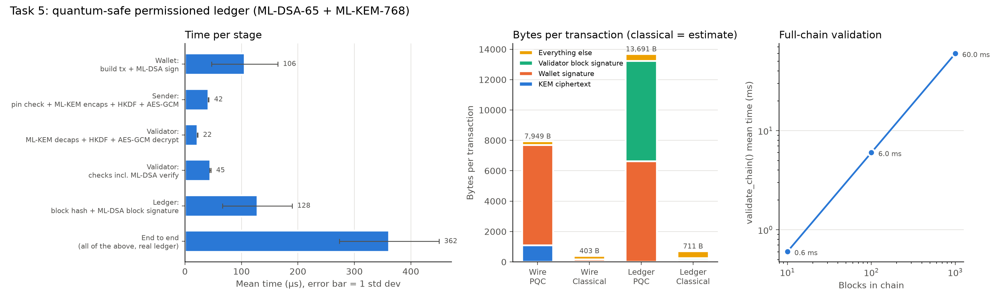

# Task 5: Post-Quantum Secure Blockchain Transactions (APPLY)

This prototype demonstrates a minimal, local, permissioned blockchain workflow using:

- ML-DSA-65 digital signatures (FIPS 204)
- ML-KEM-768 key-establishment (FIPS 203)
- HKDF-SHA-256 key derivation
- AES-256-GCM payload encryption
- SHA-256 hash-linked blocks, each signed by the validator with ML-DSA-65
- Public-key-derived wallet addresses and a trusted validator registry

Users authorize transfers with ML-DSA-65, the transaction payload is encrypted with ML-KEM-768 + HKDF + AES-256-GCM, and accepted transactions are appended to a hash-linked ledger.

> This is a local PoC, not a distributed blockchain implementation. It intentionally excludes consensus, network-wide validation, persistent storage, and full production key management.

## 1. Security problem and threat model

A future quantum computer could break classical public-key cryptography. This prototype focuses on three goals:

| Concern | Mechanism |
|---|---|
| Transaction authenticity | ML-DSA-65 signature verified against the sender's registered public key |
| Confidentiality in transit (not on the ledger, which members can read) | ML-KEM-768 shared secret, HKDF, AES-256-GCM |
| Ledger integrity | SHA-256 hash links plus ML-DSA-65 validator block signatures, checked by `ledger.validate_chain()` |

- Attacker can: read or tamper with network traffic, forge submitted transactions, replay captured transactions, and alter stored blocks.
- Attacker cannot: steal private keys or break ML-DSA, ML-KEM, or AES.
- Trusted: the registry, and the single validator not to rewrite its own history.
- Assets: wallet balances, signed transactions, encrypted payloads, ledger history.
- Out of scope: consensus, large-scale deployment, full PKI, side-channel hardening, real money.

## 2. Architecture

```text
Alice wallet                  Secure channel                   Validator node              Ledger
creates tx +    -->  ML-KEM-768 -> HKDF -> AES-256-GCM  -->  decrypt, verify,       -->  hash-linked blocks,
ML-DSA signature                                             nonce/balance checks,       balances, nonces,
                                                             signature validation        rejection log
```

The implementation is split into the following modules:

| Module | Purpose |
|---|---|
| `task5_application/main.py` | CLI entry point that runs the normal and attack demos |
| `task5_application/pqc_blockchain/wallet.py` | Wallet creation, address derivation, signed transactions |
| `task5_application/pqc_blockchain/registry.py` | Trusted wallet registry and pinned validator KEM key |
| `task5_application/pqc_blockchain/transaction.py` | Canonical transaction encoding and signing helpers |
| `task5_application/pqc_blockchain/secure_channel.py` | ML-KEM + HKDF + AES-GCM submission envelope |
| `task5_application/pqc_blockchain/validator.py` | Acceptance checks: signature, nonce, balance, and sender validity |
| `task5_application/pqc_blockchain/ledger.py` | Genesis block, transaction blocks, hash-chain validation |
| `task5_application/pqc_blockchain/node.py` | Decrypts a submission and passes it to the validator |
| `task5_application/evaluation.py` | Per-stage timing, bytes per transaction against a classical estimate, throughput and validation scaling; writes JSON and a figure to `results/` |

## 3. Transaction model

Transactions are encoded using canonical JSON bytes and signed over those bytes:

```text
Transaction { sender, recipient, amount, nonce, timestamp }
canonical bytes = sorted keys, compact JSON, UTF-8
signature = ML-DSA-65 over signing bytes
```

The sender nonce prevents same-chain replay, and each block stores the hash of the previous block so the chain can detect mutation.

## 4. Attack experiments covered

| # | Attack | Security mechanism | Expected detection |
|---|---|---|---|
| 1 | Replay an accepted transaction | Per-sender nonce + validator nonce check | the second submission is rejected because the expected nonce has already been used |
| 2 | Tamper with ciphertext | AES-256-GCM authentication tag, with the key bound to the KEM ciphertext by HKDF | changing the AES ciphertext, AES nonce or KEM ciphertext makes decryption fail with `InvalidTag` |
| 3 | Swap the validator KEM public key | trusted public-key fingerprint check before ML-KEM encapsulation | `encrypt_submission()` rejects the mismatched validator key before the encrypted payload is created |
| 4 | Change the amount or recipient after signing | ML-DSA-65 signature verification over canonical bytes | transaction verification fails because the signed payload no longer matches |
| 5 | Attempt to impersonate another wallet | ML-DSA verification against the registered sender public key | the attacker-supplied signature does not verify for the registered identity, so the transaction is rejected |
| 6 | Modify a historical block | SHA-256 hash chaining plus ML-DSA-65 validator block signatures in `Ledger.validate_chain()` | `validate_chain()` returns `False` whether the attacker only edits the block, also recomputes its hash, or also re-signs it with their own key. **Limitation:** the validator itself, or anyone holding its private key, could still rewrite history; consensus among several validators would remove that trust |

The attack demo runs these in this order: network (1, 2), sender (3), validator (4, 5), then storage (6), because attack 6 modifies the ledger.

## 5. Running the demo

Run everything from the repository root:

```bash
uv run python -m task5_application.main --mode normal
uv run python -m task5_application.main --mode attacks
uv run python -m task5_application.evaluation
```

- `--mode normal` prints the setup, one signed transfer (Alice pays Bob 25) travelling through the secure channel, and the resulting block. It ends with `Chain valid: True`.
- `--mode attacks` runs the normal flow first, then the six attacks above. Every attack must print `REJECTED`, and the last one must print `Chain valid: False`.
- `evaluation` writes `results/data/task5/evaluation.json` and `results/figures/task5/evaluation.png`.

## 6. Evaluation results (1000 runs, Linux x86-64, Python 3.12, liboqs 0.16.0)



Time per stage of one transaction (mean ± std):

| Stage | Time (µs) |
|---|---|
| Wallet: build transaction + ML-DSA sign | 105.8 ± 58.5 |
| Sender: pin check + ML-KEM encaps + HKDF + AES-GCM | 41.7 ± 0.6 |
| Validator: ML-KEM decaps + HKDF + AES-GCM decrypt | 22.3 ± 0.4 |
| Validator: checks including ML-DSA verify | 45.0 ± 1.0 |
| Ledger: block hash + ML-DSA block signature | 128.2 ± 61.5 |
| **End to end** | **361.7 ± 88.2** |

Bytes per transaction, against the same design with Ed25519 and X25519 (an estimate made by substituting their sizes; signatures are stored as hex, so each takes twice its raw size):

| Design | On the wire (B) | On the ledger (B) |
|---|---|---|
| ML-DSA-65 + ML-KEM-768 | 7,949 | 13,691 |
| Ed25519 + X25519 (estimate) | 403 | 711 |

Throughput and full-chain validation:

| Blocks | Throughput (tx/s) | Ledger size (B) | Validate chain (ms) |
|---|---|---|---|
| 10 | 2,595.9 | 137,142 | 0.60 |
| 100 | 2,745.2 | 1,369,513 | 6.00 |
| 1000 | 2,796.5 | 13,695,014 | 59.99 |

Observations:
- **Computation is not the bottleneck.** A transaction takes about 0.36 ms end to end. The two ML-DSA signing steps (wallet and block) dominate it, and their variance comes from ML-DSA's rejection sampling (Task 3).
- **Size is the cost.** The PQC design is about 20 times larger than the classical estimate, both on the wire and on the ledger, because ML-DSA-65 signatures (3,309 B) and the ML-KEM-768 ciphertext (1,088 B) are much larger than their classical counterparts. Every block stores two signatures (wallet and validator), so this directly grows the ledger.
- **Validation time grows linearly with chain length** (about 0.06 ms per block), because every block's hash link and ML-DSA signature are checked.
- Timings come from a single machine through Python, so rerun on the demo machine before quoting them.

## 7. Notes

- Wallet addresses are derived from the SHA-256 hash of the ML-DSA public key.
- The registry trusts the validator KEM public key fingerprint before a sender encrypts a fresh KEM ciphertext.
- The prototype is designed for coursework demonstration and is not intended as a production-grade blockchain implementation.
